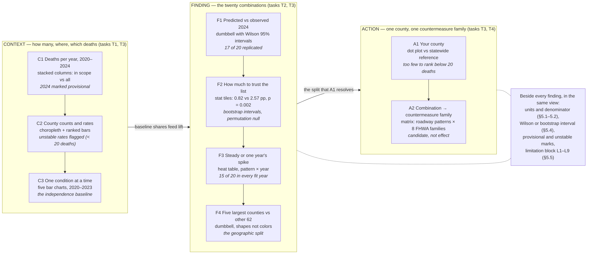

# Week 12: Narrative and Evidence Structure for the Dashboard

**Built for Cars, Deadly for Walkers: mining the roadway conditions behind Florida's pedestrian deaths, 2020–2024**

Yelysei Shkirpan · Capstone Project, B.S. Data Science · Eastern Florida State College · November 8, 2026

Repository: https://github.com/Sor1na/florida-pedestrian-patterns

**What this document is.** The design of the dashboard, written before any of it is polished: who it is for and what they do with it, the one sentence it must leave behind, the order in which the views build from context to finding to action, and, for every view, the question it answers, the chart form, the fields it reads, the comparison it makes, the annotation it carries and the uncertainty it shows. The filters, the units and denominators, the source note, the limitation text and the accessibility rules are fixed here, so that building the dashboard in Week 13 is assembly, not design. Every number quoted below comes from the one read of 2024 in [`docs/evidence/week11/`](evidence/week11) or from the Week 6 profile in [`docs/profile/`](profile); the dashboard reads the same views the report reads ([Week 9 §7](Week9_Architecture_Shkirpan.md), "one source of numbers"), so no figure on it can drift from the evidence. The machine-readable counterpart of sections 2–3 and 6 is [`dashboard/views.csv`](../dashboard/views.csv); [`tests/check_dashboard_spec.py`](../tests/check_dashboard_spec.py) checks it against the SQL views, the evidence files and the completion criteria, and CI runs that check on every change.

| Required item | Where |
|---|---|
| 1. Intended audience, task, and one-sentence takeaway | section 1 |
| 2. A context-to-finding-to-action sequence of views | section 2 |
| 3. For each view: question, chart form, source fields, comparison, annotation | section 3 |
| 4. Planned filters or interactions and their purpose | section 4 |
| 5. Units, denominators, source note, uncertainty, and limitation text | section 5 |
| 6. Accessibility: color, contrast, reading order, keyboard use, alternative text | section 6 |
| Methods basis (course text) | section 7 |
| Completion criteria | section 8 |

---

## 1. Audience, task, and the one-sentence takeaway

### 1.1 Audience

The primary reader is the one the proposal names: a **safety planner at FDOT's State Safety Office or at a Florida MPO** who, once a year, after NHTSA publishes a FARS year, decides which of the FHWA proven countermeasures for pedestrians (lighting, crossing treatments, medians and refuge islands, speed management) to fund, and in which counties and on which kinds of road first. The planner is numerate, knows the road network, reads a chart in seconds and a memo in minutes, and has to defend every number quoted to a board. Two secondary readers are designed for, not designed around: the instructor and peer reviewers, who will check that every view can be traced to the evidence, and the public, who will see the published page and must find nothing in it that describes an individual death (proposal, ethics section; Week 9 §7, the aggregates-only dashboard role).

### 1.2 The planner's tasks

The dashboard exists for four tasks. Every view in section 2 serves at least one of them, and section 2.3 lists which.

| Task | What the planner is doing | What a view must give them |
|---|---|---|
| **T1 Orient** | understand how many deaths this is about, where they happen, and what the analysis population is | counts with their denominators, the scope filter made visible, the provisional year marked |
| **T2 Rank** | decide which condition combinations to act on first, and know how far each share can be trusted for the coming year | the twenty combinations as sentences, their shares with intervals, the 2024 check, the order by lift |
| **T3 Locate** | find where each combination concentrates: which counties, and whether the statewide list applies to their county | the large-county split, the county lens, counts with a "too few to rank" guard |
| **T4 Act** | turn a combination and a county into a countermeasure family and a defensible paragraph | the countermeasure matrix, the rule-as-sentence rendering, a download of the aggregates behind the view |

### 1.3 The one-sentence takeaway

> **On Florida's urban, non-freeway roads, twenty combinations of road class, speed limit, lighting, crossing location and time of day described pedestrian deaths in 2020–2023 and held in 2024 (within 0.8 percentage points of their shares on average), but which combinations matter most differs between the five largest counties and the other 62, so countermeasure priorities should be set county by county rather than from one statewide list.**

This is the sentence a planner should be able to repeat after closing the page, and it is the only conclusion stated before the context views. It is kept inside the Week 11 bounds on purpose: it speaks of *shares of deaths* in a stated population, not of risk per pedestrian; it says the combinations *held*, not that they *cause* deaths; and it names the geographic split, which is the finding that changes what a planner does. The sentence that the dashboard must **not** leave behind is also fixed, from Week 11 §6: *"dark, unlit high-speed arterials are Florida's most dangerous pedestrian environment, and lighting them would prevent those deaths"*. No title or alternative text may use the words "most dangerous", "risk", "prevent" or "cause" (the check script enforces this), and an annotation may use them only to deny them, as the limitation blocks L1 and L2 do.

## 2. The sequence: context, then finding, then action

### 2.1 Why this order

A planner who reads only the first view must not be misled, and a planner who reads to the end must not have to take the finding on faith. So the page is one column read top to bottom in three stages. **Context** (C1–C3) establishes how many deaths, where, which of them the patterns describe, and what a planner already knew from single-condition tables, which is also the baseline the patterns are measured against. **Finding** (F1–F4) presents the twenty combinations, the evidence that they are not noise, their stability year by year, and where they live. **Action** (A1–A2) lets the planner pick a county and read the combinations and candidate countermeasure families for it. Each stage ends where the next one needs to begin: C3 ends with the independence baseline that F1 compares against; F4 ends with the geographic split that A1 is built to resolve.

(Source: [`dashboard_sequence.mmd`](dashboard_sequence.mmd); SVG: [`dashboard_sequence.svg`](dashboard_sequence.svg).)

### 2.2 The views

| # | Stage | Title as the reader sees it (a sentence, not a label) | Question answered | Core / cut first |
|---|---|---|---|---|
| **C1** | context | *3,736 pedestrians died on Florida roads in 2020–2024; 3,053 of them on urban, non-freeway roads, which is what the patterns describe* | how many, and which deaths are in the analysis population | core |
| **C2** | context | *Deaths concentrate in the large counties; rates are highest in some small ones, where they are also least stable* | where the deaths are, as counts and as rates | core |
| **C3** | context | *One condition at a time: half of the deaths were on principal arterials, two in five on 45–50 mph roads, three in four away from an intersection* | what a planner already knows from single-condition tables, and the independence baseline | cut first (folds into F1's caption) |
| **F1** | finding | *Twenty combinations named from 2020–2023 recurred in 2024; seventeen of them at or above the 3% floor* | which combinations, how large, and did they hold | core |
| **F2** | finding | *The list is three times closer to 2024 than assuming the conditions are unrelated, and nothing like it appears when the data are shuffled* | how much to trust the list | cut first (folds into F1's caption) |
| **F3** | finding | *Fifteen of the twenty were present in every year; three owe their place to one year* | steady feature or one year's spike | core |
| **F4** | finding | *The unlit high-speed arterial patterns are a small share of deaths in the five largest counties and a large share elsewhere; the lighted 45–50 mph arterial at night is the reverse* | where each combination lives | core |
| **A1** | action | *Your county: the twenty combinations by share and count, against the statewide figures* | what the list looks like for one county | core |
| **A2** | action | *From combination to candidate countermeasure family* | which FHWA proven countermeasures address the conditions in each combination | cut first (folds into A1 as a text column) |

"Cut first" applies the scope guard of the Week 8 risk register (risk 6): if Weeks 13–14 compress, C3, F2 and A2 are the first views dropped, and each has a named fallback that keeps its content on the page as text. Data quality statements, the uncertainty on every share and the limitation text are never cut.

### 2.3 Every view supports a task

| Task | Views | The question a tester must be able to answer from them (the Week 13 walk-through test) |
|---|---|---|
| T1 Orient | C1, C2, C3 | "How many deaths are in the analysis population, and what share of all pedestrian deaths is that? Which year is provisional and how much smaller is it?" |
| T2 Rank | F1, F2, F3 | "Which three roadway combinations have the largest 2024 shares, with their intervals? Which listed combination should I not quote with its pooled share, and why?" |
| T3 Locate | C2, F4, A1 | "For the unlit 55-mph arterial pattern, what share of deaths is it in the five largest counties and in the rest of the state? What is it in Volusia County, and how many deaths is that?" |
| T4 Act | A1, A2 | "Which countermeasure families address the lighted 45–50 mph arterial at night, and what paragraph with numbers could go into an Orange County memo?" |

A view that does not appear in this table has no reason to exist; none is missing from it.

## 3. The views, one by one

### 3.1 Chart forms follow comparisons

The form of each view is chosen from the comparison it has to support, before any styling. The rule used throughout: position (length, dot position on a common scale) carries the quantity, because it is the most accurately read channel; color carries at most one meaning per view and is always doubled by a label, a shape or a texture (section 6). Nominal attributes (road class, crossing location, lighting) are drawn in rank order; ordinal attributes (speed bin, time of day, year) keep their natural order (Tan et al., §2.1.1, attribute types).

| Comparison the reader makes | Chart form | Why not the alternatives |
|---|---|---|
| a whole split into two parts, over five years | stacked columns, one per year, two segments | grouped columns hide the total; a pie per year cannot be compared across years |
| a quantity by county: *locate*, then *compare* | classed choropleth beside ranked horizontal bars | a map alone compares poorly (area dominates) and cannot show counts next to rates; bars alone lose the geography |
| share of each value of one variable | horizontal bars, one hue; ranked for nominal, ordered for ordinal | a donut cannot show seven values with an "unknown" bar |
| predicted against observed, per item, with an interval | dumbbell with an interval bar on the observed end, one row per pattern | a grouped bar per pattern doubles the ink and hides the interval; a scatter loses the pattern names |
| two methods' error, a rate, a p-value | a row of stat tiles with intervals | a two-bar chart of two numbers is a stat tile with extra ink |
| one share, twenty items × five years | heat table with the number in every cell | twenty lines on one chart cannot be told apart; small multiples of twenty sparklines cannot be compared at the 3% line |
| the same share in two groups, per item | dumbbell, two marks per row told apart by shape | a diverging bar of the difference hides the two levels and whether either clears the floor |
| a county against the state, per item | dot plot with the statewide value as a reference tick | a choropleth per pattern is dominated by population and cannot carry intervals |
| condition → countermeasure family | a matrix (table) with marks | more than seven classes carrying meaning is a table's job, not a chart's |

### 3.2 View specifications

Field names are columns of the SQL views in [`sql/04_views.sql`](../sql/04_views.sql) (`v_ped_transactions`, `v_county_rate`, `v_dash_pattern_county`) or columns of the Week 11 evidence files in [`docs/evidence/week11/`](evidence/week11); the pattern list is the pre-registered one and is never re-mined on the page. Annotation text is the draft that goes on the page; "uncertainty shown" names the element that is drawn beside the finding, not in a footnote.

#### C1 — How many, and which deaths the patterns describe

**Task.** T1

**Question.** How many pedestrians died each year, how many of those deaths are in the analysis population, and which year is provisional?

**Chart form.** Stacked columns, one per year 2020–2024; lower segment = in the analysis population (urban, non-freeway), upper segment = outside it (rural, interstate or freeway, or urban/rural not coded). The 2024 column carries the provisional texture and the word "provisional" above it. Direct labels: the total above each column and the in-scope count inside the lower segment.

**Source fields.** `v_ped_transactions.year` (count = in scope); `pedestrian.year` joined to `crash` (count = all deaths); reconciled against `docs/profile/02_unit_of_observation.csv` (695 / 819 / 780 / 774 / 668 all; 588 / 674 / 644 / 625 / 522 in scope)

**Comparison.** Year against year; in scope against all

**Annotation.** "Rural roads (364 deaths), interstates and freeways (272) and 47 deaths whose urban or rural status was not coded are outside the analysis population. 2024 is the provisional Annual Report File: 13.7% fewer deaths than 2023, and 31 of its deaths (4.6%) have no urban/rural code, against at most 1.4% in a Final year. The Final file will replace it (see 'What changes when the 2024 Final file arrives')."

**Uncertainty shown.** The provisional texture and label on 2024; the count behind every segment (counts are exact: there is no sampling here, only a source that is still being corrected)

**Limitation text beside it.** L3 (provisional year), L6 (rural and freeway deaths are out of the patterns but in the county rates)

#### C2 — Where: county counts and rates

**Task.** T1, T3

**Question.** Where did the deaths happen, how do counties compare on a per-resident basis, and which rates are too small to trust?

**Chart form.** Two linked panels. Left: a choropleth of the 67 counties, deaths per 100,000 residents per year, five ordinal classes (quintiles over the 67 counties, breaks printed in the legend), counties with fewer than 20 deaths drawn with the "unstable" texture over their class color and listed by name under the map; county borders in the surface color. Right: ranked horizontal bars of deaths (count, all 3,736) for the fifteen counties with the most deaths plus one bar "the other 52 counties", with each county's rate printed as text at the bar end. The map locates; the bars compare.

**Source fields.** `v_county_rate.county_fips`, `county_name`, `deaths_all`, `deaths_in_scope`, `person_years`, `rate_per_100k_per_year`, `unstable_rate`

**Comparison.** County against county (counts); county against the state rate (a reference line on the bars' text column); counts against rates

**Annotation.** "Miami-Dade, Broward, Palm Beach, Hillsborough and Orange hold 46% of Florida's 2020–2024 person-years and 44.6% of the 2024 in-scope deaths. Thirty-three of the 67 counties recorded fewer than 20 pedestrian deaths in five years; their rates are flagged unstable and should not be ranked. Rates use all 3,736 deaths; the patterns from F1 on use the 3,053 urban, non-freeway deaths, so a rural county can have a high rate and contribute no pattern."

**Uncertainty shown.** The unstable flag (texture, the word "unstable" in the tooltip and the table, the list under the map); the death count behind every rate in the tooltip and table

**Limitation text beside it.** L6, L7 (unstable counties)

#### C3 — One condition at a time (the baseline a planner already has)

**Task.** T1 (and the baseline for T2)

**Question.** How are the in-scope deaths of 2020–2023 distributed over each of the five conditions, one condition at a time, unknowns included?

**Chart form.** Five small horizontal bar charts in one row (road class, posted speed, lighting, crossing location, time of day), share of the 2,531 fit-year deaths per value; nominal variables ranked largest first, ordinal variables (speed, time of day) in their natural order; the "unknown" bar in the context gray at the bottom of each chart; one hue, direct labels on every bar (seven or fewer bars per chart).

**Source fields.** `v_ped_transactions.road_class`, `speed_bin`, `light`, `crossing_location`, `time_of_day` for `year` ≤ 2023 (the Week 10 §3.1 table: principal arterial 52.2%, 45–50 mph 42.9%, dark-lighted 47.7%, not at intersection 72.2%, night 39.2%; speed unknown 6.2%)

**Comparison.** Part to whole within each variable

**Annotation.** "These single-condition shares are what a planner could already read from FARS tables, and they are the baseline the patterns are measured against: under independence, a combination's expected share is the product of its conditions' shares. Deaths with an unknown value stay in every denominator; no reported pattern contains an unknown. Speed is unknown for 6.2% of deaths, mostly hit-and-runs."

**Uncertainty shown.** The unknown bars themselves, drawn and labelled, never dropped

**Limitation text beside it.** L5 (unknowns and hit-and-run)

#### F1 — The twenty combinations, and whether they held in 2024

**Task.** T2

**Question.** Which combinations of the five conditions most characterised deaths in 2020–2023, how large was each as a share of deaths, and did each recur in 2024 at close to the same share?

**Chart form.** Dumbbell, one row per pattern, twenty rows, sorted by lift (default; section 4). Row label = the pattern as a sentence ("principal arterial · 55 mph or more · dark, not lighted · not at an intersection"). Blue filled circle = 2020–2023 share (the prediction); orange filled diamond = 2024 observed share, with its Wilson 95% interval as a thin bar; a gray hairline joins the two. Text columns at the right: lift (2020–2023), "replicated" (a word, not a color), and the flag "by construction" on #1 and #11. The three patterns that did not replicate carry the word "not replicated" and a hollow diamond. A common horizontal scale 0–12% of in-scope deaths with the 3% support floor drawn as a labelled reference line.

**Source fields.** `patterns_topk.csv`: `rank`, `itemset`, `fit_support`, `fit_lift`, `obs_support`, `obs_wilson_low`, `obs_wilson_high`, `obs_lift`, `obs_count`, `replicated`, `expected_by_construction`; the roadway list from `patterns_topk_roadway.csv` (section 4)

**Comparison.** Predicted against observed, per pattern; pattern against pattern by lift and by share; every observed share against the 3% floor

**Annotation.** "Seventeen of the twenty recurred in 2024 at or above the 3% floor with lift above one, and the order by lift held (Spearman 0.92). The largest roadway pattern is the lighted 45–50 mph principal arterial at night: 8.6% of deaths in 2020–2023, 8.0% [6.0, 10.7] in 2024. Pattern #4 fell under the 3% floor with its lift intact (12 deaths); #15 and #17 weakened in both share and lift. #1 and #11 pair daylight with midday or morning: true because of the sun, flagged, and not a roadway finding. A 3% share of 2024 is 16 deaths."

**Uncertainty shown.** The Wilson 95% interval bar on every 2024 share; the count behind every share in the tooltip and table ("3.3% = 17 of 522 deaths"); the replication flag as text

**Limitation text beside it.** L1 (no exposure denominator), L3, L4 (the statewide list misdescribes the large counties — "see F4"), L8 (alcohol sensitivity, as a static note: among the 253 deaths with no alcohol reported all twenty keep lift above one; alcohol is unknown for 44% of 2024 deaths)

#### F2 — How much to trust the list

**Task.** T2

**Question.** Is the list better than assuming the five conditions are unrelated, and could a list like it have come from chance?

**Chart form.** A row of three stat tiles, each with its interval or null in smaller text: (1) mean error of the list's 2024 prediction, 0.82 pp [0.66, 1.52], against the independence baseline's 2.57 pp [2.04, 3.24], drawn as two dots with interval bars on one small scale under the numbers (blue = the list, gray = independence); (2) replication 17 of 20 [0.60, 0.90]; (3) permutation check: 28 patterns in the real data, 0 in 500 shuffles, p = 0.002.

**Source fields.** `results_summary.json`: `results.top_20.mae_pp_candidate`, `mae_pp_baseline`, `mae_pp_difference`, `replication_rate`, `spearman_rank`, `coverage`, `ci95.*`; `permutation_summary.csv`: `observed`, `null_mean`, `null_p95`, `p_value_one_sided`

**Comparison.** The list's error against the baseline's error; the observed pattern count against its null distribution

**Annotation.** "The twenty shares predicted from 2020–2023 missed the 2024 shares by 0.82 pp on average; the assumption that the conditions are unrelated missed by 2.57 pp; the difference, 1.75 pp, has an interval that excludes zero. When each condition's column is shuffled on its own, which keeps every single-condition share and destroys the links between them, the miner finds on average 0.002 patterns at these thresholds and never 28. The list covers 45% of 2024 deaths; the other 55% carry none of the twenty combinations."

**Uncertainty shown.** The cluster-bootstrap intervals on both errors (drawn as bars); the null distribution's mean and 95th percentile beside the observed count

**Limitation text beside it.** L3 (one provisional hold-out year), L9 (the bins were fixed on pooled marginals); the methods note that the baseline is handicapped by construction (Week 11 §6), stated in the tile's footer so the gap is not read as the whole evidence

#### F3 — Steady feature or one year's spike

**Task.** T2

**Question.** Was each combination present in every year, or does its pooled share rest on one year?

**Chart form.** Heat table: twenty rows (same order as F1), five columns (2020, 2021, 2022, 2023, 2024 — the 2024 header carries the provisional texture and the word), cell = the pattern's share of that year's in-scope deaths, printed in every cell; four fill classes of one blue ramp (below 3%, 3–5%, 5–7%, 7% and more), the lightest meaning "below the support floor that year"; a sixth text column "in all four fit years: yes/no".

**Source fields.** `stability_by_year.csv`: `rank`, `itemset`, `support_2020` … `support_2024`, `lift_2020` … `lift_2024` (lift in the tooltip), `present_in_all_fit_years`

**Comparison.** Within a pattern, year against year; 2024 against the four fit years

**Annotation.** "Fifteen of the twenty were at or above 3% in all four fit years, and their lifts moved within narrow bands (#5: 4.87, 5.00, 4.53, 4.09, then 4.22 in 2024). Pattern #17 owes its place to 2020 (5.1%, then 2.7%, 2.6%, 2.6%) and did not replicate; a pattern that depends on one year should not be quoted with its pooled share. A 3–5% share moves by about ±1 pp from year to year, which is also the size of the 2024 error: the list is about as accurate as one year is of the next."

**Uncertainty shown.** The year's in-scope death count in each column header (588, 674, 644, 625, 522), so a cell can be read as a count; the "in all four fit years" flag; the provisional mark on 2024

**Limitation text beside it.** L3

#### F4 — Where each combination lives

**Task.** T3

**Question.** For each combination, is its 2024 share the same in the five most populous counties as in the other 62?

**Chart form.** Dumbbell, one row per pattern (same order as F1): filled ink circle = share of the 233 in-scope 2024 deaths in Miami-Dade, Broward, Palm Beach, Hillsborough and Orange; hollow ink circle = share of the 289 deaths in the other 62 counties; a short blue tick = the statewide 2020–2023 share (the prediction every planner would otherwise use). Geography is told apart by shape and by direct labels on the two ends of the four largest gaps, not by color.

**Source fields.** `subgroup_county.csv`: `group`, `n_rows`, `pattern_rank`, `itemset`, `predicted_candidate`, `observed_support`, `observed_lift`

**Comparison.** The five largest counties against the other 62, per pattern; both against the statewide prediction

**Annotation.** "The high-speed unlit arterial combinations (#5, #7, #16, #20) are 0.9%, 1.3%, 1.7% and 2.6% of 2024 deaths in the five largest counties, against 5.2%, 5.9%, 7.3% and 9.3% in the rest of the state. The lighted 45–50 mph principal arterial at night (#14) is the reverse: 9.4% in the large counties, 6.9% elsewhere. Two patterns (#15, #19) fall below lift 1 in the large counties while staying above it elsewhere; none reverses in both groups, so this is not Simpson's paradox, but the shares shift enough to change a county's priorities: the pooled list is right about the state and wrong about where each pattern lives."

**Uncertainty shown.** The two group sizes (233 and 289 deaths) in the legend, and the count behind each share in the tooltip; a 3% share of the large counties is 7 deaths, which the tooltip states

**Limitation text beside it.** L4; the note that the split is two groups fixed in advance, not 67 counties (A1 is for one county)

#### A1 — Your county

**Task.** T3, T4

**Question.** In the selected county (or group of counties), how many of the 2020–2024 in-scope deaths carry each of the twenty combinations, what share is that, and how does it compare with the statewide figure?

**Chart form.** Dot plot, one row per pattern (same order as F1): ink dot = the county's share of its own in-scope deaths 2020–2024, with a Wilson 95% interval bar; blue tick = the statewide 2020–2023 share; text columns: count, share, interval. When the county has fewer than 20 in-scope deaths in 2020–2024, shares and intervals are not drawn: the row shows the count and the words "too few to rank", and the title says so. The county's rate, death count and unstable flag from C2 repeat in the view's header.

**Source fields.** `v_dash_pattern_county.county_fips`, `county_name`, `road_class`, `speed_bin`, `light`, `crossing_location`, `time_of_day`, `deaths` (summed over the cells that contain the pattern's items); `v_county_rate` for the header; the statewide reference from `patterns_topk.csv.fit_support`

**Comparison.** The county against the state, per pattern; pattern against pattern within the county

**Annotation.** A sentence generated from the data in a fixed template: "[County]: [N] urban, non-freeway deaths in 2020–2024. [Pattern 1] accounts for [k₁] of them ([share₁] [low, high]), against [statewide share₁] statewide; [pattern 2] for [k₂] ([share₂] [low, high]), against [statewide share₂]." The two patterns named are the county's largest by share among the twenty; below 20 deaths the template reads "[County]: [N] urban, non-freeway deaths in 2020–2024, too few to rank; counts are shown without shares." The template is the design; the values come from `v_dash_pattern_county` at build time.

**Uncertainty shown.** The Wilson interval on every county share; the "too few to rank" guard below 20 deaths; the count beside every share

**Limitation text beside it.** L1, L7; the statement that the twenty combinations were chosen statewide, so a county may have a large share of deaths under a combination that is not on the list (its full five-item table is in the download)

#### A2 — From combination to candidate countermeasure family

**Task.** T4

**Question.** Which of FHWA's proven safety countermeasures address the conditions in each roadway combination, and how much of the selected county's deaths does that combination carry?

**Chart form.** A matrix (table). Rows: the patterns of the selected list that contain a road-class, speed or crossing item (18 of the primary 20, the two by-construction pairs left out; all 20 of the roadway list). Columns: the FHWA proven-countermeasure families relevant to the conditions — Lighting; Crosswalk Visibility Enhancements; Pedestrian Hybrid Beacons and Rectangular Rapid Flashing Beacons (mid-block crossings); Medians and Pedestrian Refuge Islands; Road Diets; Appropriate Speed Limits for All Road Users and Speed Safety Cameras; Leading Pedestrian Interval; Walkways. A filled mark where a family addresses one of the pattern's conditions, by eight written rules (for example dark, not lighted → Lighting; 45 mph and above → speed management; not at an intersection → PHB/RRFB and, on arterials or fast roads, medians and refuge islands; at or related to an intersection → Leading Pedestrian Interval). The rules are in [`dashboard/README.md`](../dashboard/README.md), applied by the check script, and are a draft for the planner to correct in the Week 13 walk-through. Two leading text columns repeat the pattern's statewide share and the selected county's share and count from A1.

**Source fields.** The pattern list (`patterns_topk.csv.itemset` or `patterns_topk_roadway.csv.itemset`); the county figures from A1; the matrix itself, [`dashboard/countermeasures.csv`](../dashboard/countermeasures.csv), generated from the rules by `python tests/check_dashboard_spec.py --write-countermeasures`

**Comparison.** Lookup: condition → family; the row's share says how much of the problem the family could be aimed at

**Annotation.** "The marks say which proven countermeasure families are designed for the conditions in a combination. They do not say what any measure would prevent here: FARS counts deaths, not crossings or pedestrian-miles, and the analysis has no comparison with roads of the same class and traffic that were treated. The matrix is a checklist for the engineer's site review, not a result of the mining."

**Uncertainty shown.** Inherited from A1 (interval and count on the county share); the word "candidate" in the title and the column header

**Limitation text beside it.** L1, L2 (descriptive, not causal)

## 4. Filters and interactions

One filter row sits above the views and scopes everything below it; every chart re-renders against the same selection so the numbers on the page always agree with each other. Controls are standard HTML form controls, keyboard-reachable in reading order (section 6.4). The page state (list, sort, county) is written into the URL, so a view can be linked from a memo and reopened exactly.

| Control | Type and options (default first) | Scopes | Purpose |
|---|---|---|---|
| **Pattern list** | radio: *primary top-20* / *roadway top-20* | F1, F3, F4, A1, A2 | the roadway list, pre-specified in Week 10 §5.2 before the test, removes the two sun-driven pairs; both lists are pre-registered, and no other list can be produced on the page |
| **Sort** | radio: *by lift (2020–2023)* / *by 2020–2023 share* / *by 2024 share* | F1, F3, F4, A1, A2 (one order for all) | lift is the "fund first" order of the proposal; share is the "how much of the problem" order; one sort for every pattern view so a row keeps its position when the eye moves between views |
| **County** | combobox: *statewide* / *five most populous* / *other 62 counties* / one of 67 counties | A1, A2 (and highlights the county on C2) | Objective 3: the list for one county, with the 20-death guard |
| **Pattern highlight** | click or Enter on a row in F1 (or a cell in A2) | F1, F3, F4, A1, A2 | the same pattern lights up in every view; Escape clears it |
| **Rule-as-sentence** | toggle: *combination* / *rule with confidence* | F1, A1, A2 row labels | "55 mph or more · dark, not lighted · not at an intersection — 5.0% of deaths" becomes "If 55 mph or more and dark, not lighted, then not at an intersection (confidence 0.92)", from `patterns_rules.csv` |
| **View as table** | toggle on every chart | that chart | every number on the chart, in a sortable table with the same denominators; the accessibility twin and the copy-paste source for memos |
| **Download** | button on every table | that table | a CSV of the aggregates behind the view with a header row of units; the county × pattern table (67 × 20 and totals) for A1, never the full five-item cross-classification, never a person-level field |
| **Tooltip / focus readout** | hover and keyboard focus on every mark | the mark | the value first, then its count, interval, lift and flags; the same text on focus as on hover; never the only place a value lives |
| **Reset** | button | all | returns to the defaults (primary list, by lift, statewide) |

**What is deliberately not offered.** No year filter: the forward split (train 2020–2022, validate 2023, test 2024) is the story, and letting a reader re-cut the years would turn the pre-registered test into an exploration; 2024 is always shown and always marked provisional. No minimum-support or minimum-lift slider: the thresholds were locked before 2024 was read ([`analysis/locked_params.json`](../analysis/locked_params.json)), and a page that re-mines on demand would quietly produce post-hoc patterns with the same visual authority as the tested ones (Tan et al., ch. 10). No filters on age, sex or alcohol: they are person attributes the dashboard role cannot read, and alcohol is unknown for 44% of 2024 deaths; the alcohol sensitivity appears as a fixed note under F1. No corridor labels (`tway_id`): named streets are the first item cut by the scope guard, and a street name next to a count of one or two deaths is closer to a person than the ethics section allows.

**What changes when the 2024 Final file arrives.** The pipeline reloads it (Week 7 §6.5), `test` runs again with `--force "2024 Final file"`, and the page shows both results side by side: the provisional texture moves to a second column in F3 and a second diamond in F1 labelled "2024 Final"; the source note names both releases.

## 5. Units, denominators, source note, uncertainty, and limitation text

### 5.1 Units

| Quantity | Unit and format | Where |
|---|---|---|
| deaths | count of pedestrian fatalities, integer, thousands separator | C1, C2, A1, every tooltip and table |
| share | percent of in-scope deaths in the stated population, one decimal ("8.0%") | C3, F1, F3, F4, A1, A2 |
| error, bias | percentage points of share, two decimals ("0.82 pp") | F2 |
| rate | deaths per 100,000 residents per year, two decimals | C2, A1 header |
| lift | ratio of observed to independence-expected share, two decimals; 1.00 = no association | F1, F3 tooltips, A1 |
| confidence | 0–1, two decimals, only in the rule rendering | F1, A1, A2 |
| interval | 95%, written "[low, high]" in the same unit as the value | everywhere a share or an error appears |
| p-value | one-sided, three decimals | F2 |

### 5.2 Denominators

Every share on the page names its denominator in the axis title or the column header, because the page uses more than one.

| View | Numerator | Denominator | Size |
|---|---|---|---|
| C1 | deaths per year, in scope and all | — (counts) | 3,736 all; 3,053 in scope |
| C2 rate | all pedestrian deaths in the county, 2020–2024 | county person-years: the sum of the five July 1 resident estimates (Census Vintage 2025) | 67 counties |
| C2 bars | all deaths in the county | — (counts); the state total 3,736 for the share in the tooltip | |
| C3 | fit-year deaths with the value | in-scope deaths of 2020–2023 | 2,531 |
| F1 prediction | fit-year deaths carrying the pattern | in-scope deaths of 2020–2023 | 2,531 |
| F1 observed | 2024 deaths carrying the pattern | in-scope deaths of 2024 (Annual Report File) | 522 (in 516 crashes) |
| F2 | mean absolute error over the twenty patterns | — (pp) | 20 patterns |
| F3 | deaths carrying the pattern in that year | in-scope deaths of that year | 588 / 674 / 644 / 625 / 522 |
| F4 | 2024 deaths carrying the pattern in the group | in-scope 2024 deaths of the group | 233 / 289 |
| A1, A2 | 2020–2024 deaths carrying the pattern in the county | in-scope deaths of the county, 2020–2024 | per county; shares suppressed below 20 |

Two rules follow from the Week 6 plan and are repeated in the page footer: deaths with an unknown value stay in every denominator (so a share is always "of all in-scope deaths", not "of deaths with a known speed"), and the county rates use all deaths while the patterns use in-scope deaths, so the two are never divided into each other.

### 5.3 Source note

Printed once in the footer and repeated in short form ("Source: FARS 2020–2024 (2024 provisional); Census Vintage 2025. Shares of urban, non-freeway pedestrian deaths.") under every view that can be exported or screenshotted on its own:

> **Source.** National Highway Traffic Safety Administration, Fatality Analysis Reporting System (FARS), National CSV files: 2020, 2021, 2022 and 2023 Final files and the 2024 Annual Report File (provisional), downloaded 2026-09-27 and pinned by SHA-256 (`pipeline/sources.csv`). Pedestrian deaths are person records coded pedestrian (PER_TYP 5) with a fatal injury (INJ_SEV 4) in Florida crashes (STATE 12). Population: U.S. Census Bureau, Vintage 2025 county resident population estimates, July 1 of each year. Patterns were mined on 2020–2023 and tested once on 2024 by a pre-registered experiment (`docs/Week10_Experiment_Design_Shkirpan.pdf`, `docs/Week11_Evaluation_Shkirpan.pdf`); the numbers on this page are in `docs/evidence/week11/`. Prepared by Yelysei Shkirpan, Eastern Florida State College, capstone project, November 2026. No person-level data is on this page or in its downloads.

### 5.4 Uncertainty: what is shown, where, and how

The rule: uncertainty is drawn beside the number it belongs to, in the same view, at the same time, never behind a toggle or in a footnote only.

| Element | How it is drawn | Views |
|---|---|---|
| Wilson 95% interval on an observed share | a thin bar through the observed mark, in the mark's color at 60% opacity, with "[low, high]" in the tooltip and the table | F1, A1 |
| cluster-bootstrap 95% interval on an error or rate | a thin bar through the dot in the stat tile, with the bracketed interval in text | F2 |
| count behind every share | in the tooltip and table ("3.3% = 17 of 522 deaths"), and in the column header of F3 and the legend of F4 | all pattern views |
| permutation null | the null mean and 95th percentile printed beside the observed value, with p | F2 |
| replication flag | the words "replicated" / "not replicated" in a text column and a hollow mark | F1 |
| stability flag | the text column "in all four fit years" | F3 |
| unstable county rate (fewer than 20 deaths) | texture over the class color, the word "unstable" in the tooltip and table, the names listed under the map | C2 |
| too few to rank (county with fewer than 20 in-scope deaths) | shares and intervals not drawn; the count and the words shown instead | A1, A2 |
| provisional year | the texture and the word "provisional" on every 2024 mark, column and header | C1, F1, F3, F4 |

### 5.5 Limitation text

Each block is at most forty words, written once here, and placed beside the views listed in section 3.2 (the "Limitation text beside it" line of each view), not collected at the bottom of the page.

| Id | Text | Beside |
|---|---|---|
| **L1** | *These are shares of deaths, not risk. FARS counts deaths, not crossings or pedestrian-miles, so a large share says where deaths happen, not where a pedestrian is most likely to be killed.* | F1, A1, A2 |
| **L2** | *This analysis is descriptive. It has no comparison with treated roads of the same class and traffic, so it does not estimate what any countermeasure would prevent.* | A2 |
| **L3** | *2024 is the provisional Annual Report File: 13.7% fewer deaths than 2023 and 4.6% of them uncodable to the analysis population. Every 2024 figure will be re-read when the Final file is loaded.* | C1, F1, F2, F3 |
| **L4** | *The statewide list is right about the state and wrong about where each pattern lives: unlit high-speed arterial patterns are 1–3% of deaths in the five largest counties and 5–9% elsewhere. Check the county view before quoting a pattern.* | F1, F4 |
| **L5** | *Deaths with an unknown value stay in every denominator and no pattern contains an unknown. Speed is unknown for 6% of deaths, most of them hit-and-runs, so patterns with a speed item under-represent hit-and-run deaths.* | C3, F1 |
| **L6** | *The patterns describe urban, non-freeway roads only: 3,053 of 3,736 deaths. County rates use all deaths, so a rural county can have a high rate and contribute no pattern.* | C1, C2 |
| **L7** | *A rate or share built on fewer than 20 deaths is flagged unstable and is not ranked; one multi-victim crash can move it by several deaths.* | C2, A1 |
| **L8** | *Alcohol involvement is unknown for 44% of 2024 deaths, so no claim about impairment is made. Among the 253 deaths with no alcohol reported, all twenty combinations keep lift above one.* | F1 |
| **L9** | *The speed and time-of-day bins were fixed in Week 6 from pooled single-variable frequencies that included 2024; the patterns measure joint structure, which that binning did not look at, but the contamination is disclosed.* | F2, methods footer |

## 6. Accessibility, designed in

The bar is WCAG 2.1 level AA: contrast (1.4.3 text, 1.4.11 non-text), information not conveyed by color alone (1.4.1), keyboard operability (2.1.1) with a visible focus (2.4.7), meaningful sequence (1.3.2), reflow to 320 px without loss (1.4.10), no motion that cannot be turned off (2.3.3), and a name, role and value for every control (4.1.2). The rules below are requirements on whatever tool builds the page in Week 13; a tool that cannot meet them is not used.

### 6.1 Color

Color carries at most one meaning per view and is always doubled by another channel. The hex values are taken from a reference chart palette that was validated, rather than eyeballed, with a palette validator (the data-visualization method of the AI assistant used in this project; its script is not part of this repository). So that the claims below can be checked without that tool, [`tests/check_dashboard_spec.py`](../tests/check_dashboard_spec.py) recomputes every one of them from [`dashboard/palette.csv`](../dashboard/palette.csv) and [`dashboard/palette_roles.csv`](../dashboard/palette_roles.csv): the lightness band and chroma floor in OKLCH, the separation of the two series colors under simulated protanopia and deuteranopia (Machado, Oliveira & Fernandes, 2009, severity 1.0; Euclidean distance in OKLab × 100) and under normal vision, the monotone one-hue ramps, and the WCAG 2 contrast ratios. The numbers quoted here are the numbers that check prints.

| Role | Hex | Meaning on this page | Doubled by |
|---|---|---|---|
| series 1, blue | `#2a78d6` | 2020–2023: the fit years, the prediction, the list | filled circle or tick; the legend word "2020–2023" |
| series 2, orange | `#eb6834` | 2024: the held-out, provisional year | filled diamond (hollow when not replicated); the word "2024" |
| context gray | `#898781` | reference and residue: the independence baseline, out-of-scope deaths, unknown values | position (bottom bar, gray tile) and the label |
| sequential blue ramp, 5 steps | `#86b6ef` `#5598e7` `#2a78d6` `#1c5cab` `#0d366b` | magnitude: the rate classes on the map (C2) | class breaks printed in the legend; the number in the tooltip and table; county borders in the surface color |
| sequential blue ramp, 4 steps | `#86b6ef` `#5598e7` `#1c5cab` `#0d366b` | magnitude: the share classes in the heat table (F3) | the number printed in every cell |
| texture | 45° hairlines in a darker step of the fill's own hue | provisional (2024); unstable (fewer than 20 deaths) | the word, always, in the label and the tooltip |
| primary ink | `#0b0b0b` | titles, numbers, focus ring | |
| secondary ink | `#52514e` | axis labels, annotations, F4 and A1 marks | |
| surface | `#fcfcfb` | chart surface; county borders | |

Results (light surface `#fcfcfb`): the two series colors sit inside the lightness band (L 0.58 and 0.67) with chroma 0.16 and 0.18, and are ΔE 24.7 apart under simulated protanopia (31.7 deuteranopia) and 33.6 under normal vision, far above the 8 and 15 floors; the context gray has chroma 0.009, so it cannot be mistaken for a third series; the five-step map ramp and the four-step heat-table ramp fall monotonically in lightness (0.76 → 0.34) with every adjacent step at least 0.09 apart, one hue (3.6° spread), and a light end of 2.06:1 against the surface. No red–green pair encodes anything; no diverging palette is used (the dumbbell carries the direction of a change by position); the map and the heat table use one hue; status colors are not used, because "not replicated" and "unstable" are stated in words and texture. The series count never exceeds two on any view where any two marks can sit side by side (map, dot plots).

### 6.2 Contrast

Ratios are WCAG 2 luminance contrast, computed by the check script from `dashboard/palette.csv` against the surface `#fcfcfb` unless another background is named; the script fails if a quoted ratio and the computed one differ.

| Pair | Ratio | Requirement | Verdict |
|---|---|---|---|
| primary ink on surface | 19.17:1 | 4.5:1 (text) | pass |
| secondary ink on surface (axis labels, annotations, 14 px and up) | 7.73:1 | 4.5:1 | pass |
| link color `#0969da` on surface | 5.06:1 | 4.5:1 | pass |
| blue series on surface | 4.30:1 | 3:1 (non-text) | pass |
| orange series on surface | 3.12:1 | 3:1 | pass |
| context gray on surface | 3.50:1 | 3:1 | pass; never used for text smaller than 18.7 px |
| focus ring, primary ink, 2 px plus 2 px surface offset | 19.17:1 | 3:1 | pass |
| heat-table text: primary ink on `#86b6ef` / `#5598e7` | 9.33:1 / 6.59:1 | 4.5:1 | pass |
| heat-table text: white on `#1c5cab` / `#0d366b` | 6.63:1 / 11.95:1 | 4.5:1 | pass |
| adjacent map classes | 1.42:1 to 1.80:1 | 3:1 between adjacent colors that carry meaning | **does not pass on its own**; mitigated: county borders in the surface color (11.6:1 against the darkest class), the class value in the tooltip and table, the map used to locate, never to compare |
| blue against orange, when marks touch | 1.38:1 | 3:1 | **does not pass on its own**; mitigated: different shapes, a 2 px surface ring on overlapping marks, the legend and the table |

No text is placed inside a colored mark except in the heat table, whose cell colors were chosen for it. Gridlines (`#e1e0d9`, 1.29:1) carry no information and are allowed to be faint. Dark mode is not shipped in Week 13: the page prints and is screenshotted into memos, and one validated light palette is safer than two half-validated ones; `color-scheme: light` is declared so the browser does not invert it.

### 6.3 Reading order

The visual order, the document order and the tab order are the same, top to bottom, one column, so a screen reader, a keyboard user and a sighted reader meet the content in the same sequence: page title → the one-sentence takeaway → the filter row → C1, C2, C3 → F1, F2, F3, F4 → A1, A2 → source note, limitations, methods. Within a view the order is fixed: heading (the sentence title, an `h3`) → one paragraph that states the finding in words with its numbers → the chart → the annotation → "view as table" → the limitation blocks. The paragraph comes before the chart so that a reader who cannot see the chart has already been told what it shows. Headings nest `h1` (page) → `h2` (stage: context, finding, action) → `h3` (view); landmarks are `header`, `nav` (a skip link to the first view and to each stage), `main`, `footer`. Nothing is positioned out of document order with CSS. At 320 px width or 200% zoom the column stays one column, charts re-render to the container width, the filter row wraps, and tables scroll horizontally inside their own region with a visible caption.

### 6.4 Keyboard use

- Every control in section 4 is a native `button`, `input type="radio"`, `select` or a combobox with the WAI-ARIA combobox pattern; Tab and Shift+Tab reach them in reading order; Space, Enter and the arrow keys operate them.
- Every chart is one tab stop that lands on a group with an accessible name; inside it, the arrow keys move a roving focus across the marks (rows in F1, F3, F4, A1; columns in C1; bars in C2 and C3), Enter selects a pattern or a county (the same as a click), Escape clears the highlight and closes the tooltip. The tooltip is attached to the focused mark by `aria-describedby`, so what hover shows, focus reads.
- The map is not a keyboard maze of 67 polygons: Tab lands on a listbox of counties sorted by name; arrow keys move through it, the map highlights the focused county, and Enter sets the county filter. Pointer users can click polygons; both routes set the same state.
- The focus indicator is a 2 px primary-ink outline separated from the element by a 2 px surface-colored offset, on every focusable element and never removed; because of the offset the ring always sits on the surface (19.17:1), whatever the fill of the focused mark.
- No information is hover-only: every tooltip value is also in the table view, which is a real `table` with `th` headers and a `caption`, sortable by keyboard.
- No keyboard trap: tooltips and the combobox popup close with Escape and return focus to the control that opened them. No time limits, no autoplay, no content that moves; `prefers-reduced-motion` turns off the only transition (the 150 ms highlight fade).
- A skip link ("skip to the twenty combinations") is the first focusable element.

### 6.5 Alternative text

Every chart has three layers: an accessible name (`aria-label`: the view's sentence title from section 2.2), a description (`aria-describedby`: the alternative text drafted below, which states the finding with its numbers and is also the visible paragraph above the chart), and the table view with the complete data. Decorative elements (gridlines, the hairlines joining dumbbell ends, textures) are `aria-hidden`. The drafts are written as findings rather than as descriptions of ink, so that a reader who hears them gets what a sighted reader sees; every number in them is one the table confirms.

| View | Alternative text (the description read after the name) |
|---|---|
| C1 | "Stacked columns of Florida pedestrian deaths per year, 2020 to 2024: 695, 819, 780, 774 and 668, of which 588, 674, 644, 625 and 522 were on urban, non-freeway roads. 2024 is provisional." |
| C2 | "Map of Florida's 67 counties shaded by pedestrian deaths per 100,000 residents per year, 2020–2024, with 33 low-count counties marked unstable, beside ranked bars of deaths by county: Miami-Dade, Broward, Palm Beach, Hillsborough and Orange hold 44.6% of 2024 in-scope deaths." |
| C3 | "Five bar charts of the share of 2020–2023 urban, non-freeway deaths by road class, posted speed, lighting, crossing location and time of day. Largest values: principal arterial 52.2%, 45–50 mph 42.9%, dark and lighted 47.7%, not at an intersection 72.2%, night 39.2%; speed unknown 6.2%." |
| F1 | "Dumbbell chart of twenty condition combinations: share of 2020–2023 deaths against share of 2024 deaths with 95% intervals. Seventeen of twenty recurred at or above 3% with lift above one; the lighted 45–50 mph principal arterial at night is the largest, 8.6% then 8.0%." |
| F2 | "Three figures: the list's mean 2024 error 0.82 percentage points, interval 0.66 to 1.52, against 2.57 for independence; replication 17 of 20; 28 patterns in the real data and none in 500 shuffles, p 0.002." |
| F3 | "Heat table of each combination's share of deaths in 2020, 2021, 2022, 2023 and provisional 2024. Fifteen of twenty were at or above 3% in every fit year; combination 17 was 5.1% in 2020 and under 3% after." |
| F4 | "Dumbbell chart of each combination's 2024 share in the five most populous counties against the other 62. Unlit 55 mph arterial combinations are 1 to 3% in the large counties and 5 to 9% elsewhere; the lighted 45–50 mph arterial at night is 9.4% against 6.9%." |
| A1 | "Dot plot of the twenty combinations in [county]: share of its [N] urban, non-freeway deaths 2020–2024 with 95% intervals, against the statewide 2020–2023 share." (The template fills the county name, N and, below 20 deaths, replaces the sentence with "fewer than 20 deaths: counts shown, shares not ranked.") |
| A2 | "Table of the roadway combinations of the selected list against eight FHWA proven countermeasure families, marking which families address each combination's conditions, with the combination's statewide and county shares." |

### 6.6 Checks before the Week 13 walk-through

Automated: axe-core and Lighthouse accessibility audits with zero violations; `tests/check_dashboard_spec.py` run against the hex values the built page actually declares in its CSS variables; a check that every `svg` or `canvas` has an accessible name and an associated table. Manual: the whole page operated with the keyboard only, by someone other than the author; F1 and C2 read with NVDA in Firefox and the finding written down from what was heard; the page viewed in grayscale and under a protanopia and deuteranopia simulation (the browser's rendering emulation); printed to PDF with the texture on; zoomed to 200%. The planner walk-through of section 2.3 is run after these pass, not before.

## 7. Methods basis

The design follows the course text (Tan, Steinbach, Karpatne, & Kumar, 2019, *Introduction to Data Mining*, 2nd ed.) in these places:

- **Chapter 2, Data, §2.1.1 (attribute types).** The five item variables are nominal (road class, lighting, crossing location) or ordinal (speed bin, time of day, year); section 3.1 draws nominal values in rank order and ordinal values in their own order, and never encodes a nominal attribute with a value ramp.
- **The "Exploring Data" chapter, §3.3 Visualization** (first-edition chapter 3; removed from the second edition's print copy and published by the authors on the book's website). Its general concepts — *representation* (the mapping of data to visual form), *arrangement* (the placement of elements so that comparisons are easy) and *selection* (showing a subset so that the rest is not lost in clutter) — are the three decisions of section 3: position for every quantity, one shared order of rows across the pattern views, and twenty pre-registered patterns rather than all 28. Its "Do's and Don'ts" (§3.3.5), the ACCENT principles (apprehension, clarity, consistency, efficiency, necessity, truthfulness) and Tufte's guidance to show the data, avoid distortion, encourage comparison and integrate graphics with words, are the reasons for one axis scale per view, one sort for all pattern views, direct labels in place of color legends where possible, and a sentence before every chart.
- **Chapter 5, §5.7 (evaluation of association patterns).** Lift is the interestingness measure shown on the page, defined as observed over independence-expected share, which is why C3 exists: it shows the marginals that define the baseline. Simpson's paradox (§5.7.3) is the reason F4 and A1 exist and why the pooled list is never shown without the geographic split.
- **Chapter 10, Avoiding False Discoveries.** The permutation null in F2 is the swap-randomisation test of the chapter; the decision not to offer threshold sliders or a year filter (section 4) follows its warning that a hypothesis space enlarged after the data are seen produces findings with the same appearance as pre-registered ones.

## 8. Completion criteria

| Criterion | Where it is met |
|---|---|
| Every view supports an audience task | §1.2 defines T1–T4; §2.3 maps every view to a task and to the walk-through question it must answer; `tests/check_dashboard_spec.py` fails if a view in `dashboard/views.csv` has no task |
| Chart forms match the comparisons | §3.1 derives every form from its comparison and says why the alternatives were rejected; each view in §3.2 states the comparison next to the form; the check script confirms every form is one of the forms listed for its comparison |
| The sequence provides context before conclusions | §2.1–2.2: three context views before any pattern is shown, the baseline (C3) immediately before the patterns (F1), the geographic split (F4) before the county tool (A1); the one conclusion stated first (§1.3) is scoped to shares of deaths; the check script verifies the stage order |
| Uncertainty and limitations appear beside the findings | §5.4 names the element drawn beside every number; §5.5 writes nine limitation blocks and §3.2 places each next to specific views; the check script fails if a finding or action view lists no uncertainty element or no limitation block |
| Accessibility is designed from the beginning | §6: a palette whose colour-vision separation, ramps and contrast ratios are recomputed by the check script, with two documented mitigations, a fixed reading order, keyboard rules per control and per chart, drafted alternative text for every view, and the pre-walk-through checks; the check script verifies every view has non-empty alt text and that the palette's contrast ratios clear 3:1 (marks) and 4.5:1 (text) |

---

## Sources and AI assistance

- Tan, P.-N., Steinbach, M., Karpatne, A., & Kumar, V. (2019). *Introduction to data mining* (2nd ed.). Pearson. §2.1.1; §5.7; chapter 10; and the "Exploring Data" chapter (§3.3, Visualization), published on the book's website as a supplement to the second edition.
- Federal Highway Administration. (2021/2024). *Proven safety countermeasures* (FHWA-SA-21-071 and the PSC website). https://highways.dot.gov/safety/proven-safety-countermeasures
- W3C. (2018). *Web Content Accessibility Guidelines (WCAG) 2.1*. https://www.w3.org/TR/WCAG21/
- Machado, G. M., Oliveira, M. M., & Fernandes, L. A. F. (2009). A physiologically-based model for simulation of color vision deficiency. *IEEE Transactions on Visualization and Computer Graphics, 15*(6), 1291–1298. (The colour-vision-deficiency simulation implemented in `tests/check_dashboard_spec.py`.)
- National Highway Traffic Safety Administration. (2026). *FARS National CSV files 2020–2024* (2024: Annual Report File). https://static.nhtsa.gov/nhtsa/downloads/FARS/
- U.S. Census Bureau. (2026). *County population totals 2020–2025, Vintage 2025*. https://www.census.gov/data/tables/time-series/demo/popest/2020s-counties-total.html
- This repository: `docs/Week11_Evaluation_Shkirpan.md` and `docs/evidence/week11/` (every number quoted), `docs/Week10_Experiment_Design_Shkirpan.md` §3.1 and §5.2 (the item shares and the roadway list), `docs/Week8_Midpoint_Shkirpan.md` §8–9 (the scope guard and the schedule), `docs/Week6_Data_Cleaning_Plan_Shkirpan.md` §5 (the bias statements the limitation text condenses), `sql/04_views.sql`, `dashboard/views.csv`, `dashboard/countermeasures.csv`, `tests/check_dashboard_spec.py`.

I used Claude (Anthropic), an AI assistant, to help draft this design from the Week 10–11 evidence, to run the palette validator and contrast computations, and to write the view specification and its check script. The audience, the question, the pre-registered pattern list, the bounded claims and the ethics rules come from my approved proposal and my Week 4–11 work; the views, their order, the interactions and the accessibility rules were decided in this document. I reviewed the generated material against the evidence files, and I am responsible for the content.
