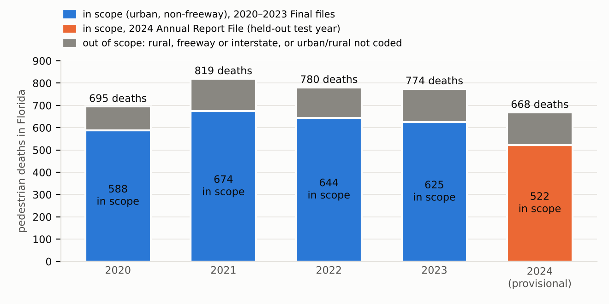
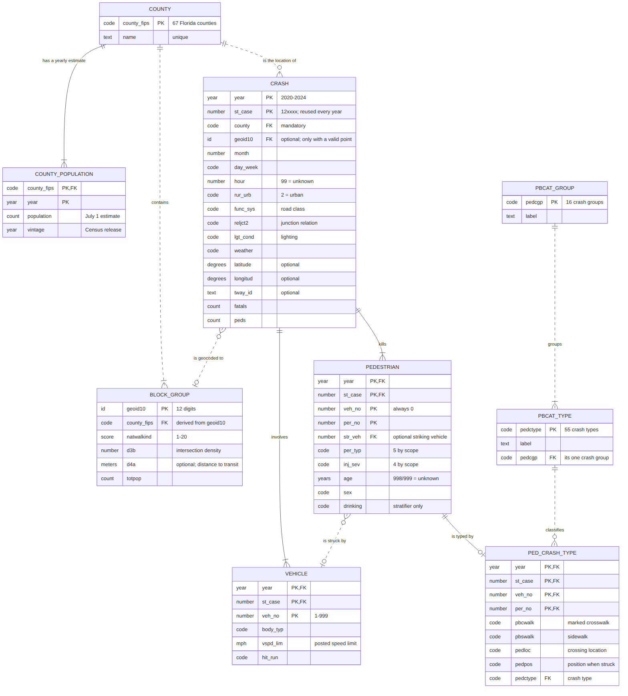
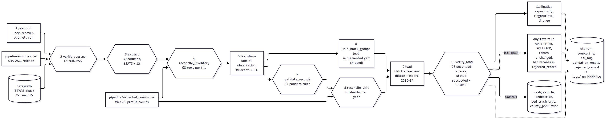
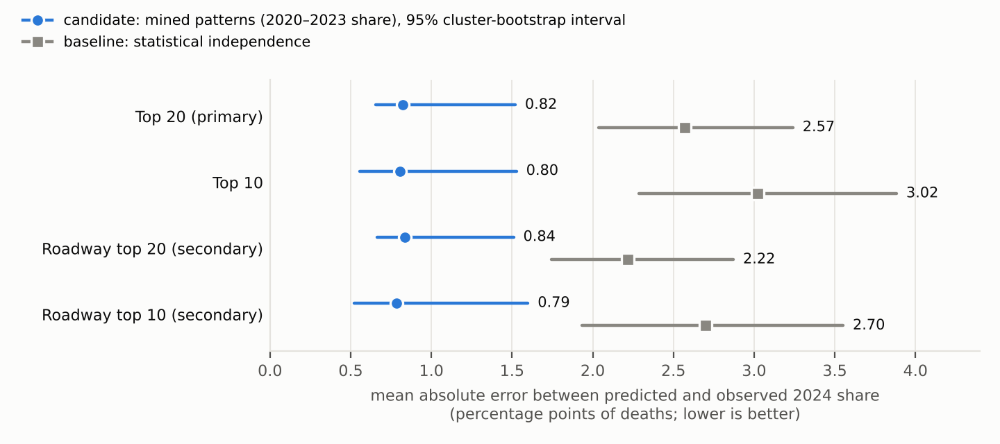
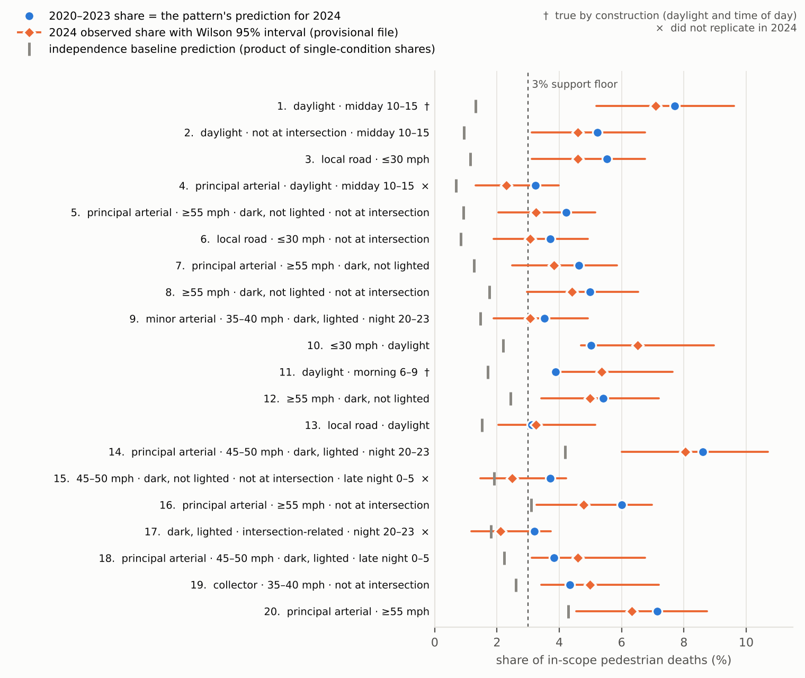
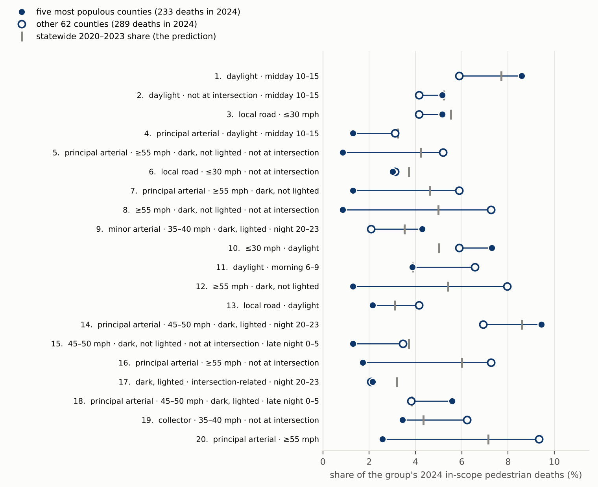

# Built for Cars, Deadly for Walkers

**Technical report (complete draft for revision): the roadway conditions behind Florida's pedestrian deaths, 2020–2024**

Yelysei Shkirpan · Capstone Project, B.S. Data Science · Eastern Florida State College · November 15, 2026

Repository: https://github.com/Sor1na/florida-pedestrian-patterns

**What this document is.** A complete draft of the final technical report. It brings the Week 4–12 deliverables into one argument, from the question to the recommendations. It is written to be revised: the last section is a short memo that names the three areas where I most need feedback. Every number below comes from a file in the repository, and each section names the files it uses.

| Required item | Where |
|---|---|
| Title, executive summary, context, audience, central question | title, executive summary, section 1 |
| Data sources, provenance, governance, ethics, quality, limitations | section 2 |
| Database design and pipeline architecture | section 3 |
| Analytical methods, experiment design, evaluation, reproducibility | section 4 |
| Results with numbered tables and figures discussed in the text | section 5 (Tables 7–10, Figures 4–6) |
| Interpretation, limitations, recommendations, responsible-use statement | section 6 |
| References and appendices (setup, schema, supporting material) | References, Appendices A–C |
| Revision memo: three areas where feedback is most needed | last section |

---

## Executive summary

From 2020 through 2024, 3,736 pedestrians were killed in Florida crashes. Of these, 3,053 died on urban roads that are not freeways. This project asks which combinations of road class, posted speed, lighting, crossing location and time of day characterize those deaths, and where each combination concentrates.

I built three things. The first is a PostgreSQL database of 16 tables that stores every death as one row with its codes exactly as NHTSA published them. The second is a pipeline with six validation gates that loads the five FARS years and the Census estimates in 22 seconds and can be rerun safely. The third is a pre-registered experiment. It mines combinations on 2020–2023 and tests them once on 2024, a year the method never saw.

The main result: the twenty combinations named from 2020–2023 predicted their 2024 shares of deaths to within 0.82 percentage points (pp) on average (95% interval 0.66–1.52). The assumption that the five conditions are unrelated missed by 2.57 pp (2.04–3.24). Seventeen of the twenty combinations recurred. When the data are shuffled so that the joint structure is destroyed, nothing like this list appears (p = 0.002).

Three roadway combinations stand out. Lighted principal arterials posted 45–50 mph at night carried 8.6% of deaths in 2020–2023 and 8.0% in 2024. Principal arterials posted 55 mph or more, dark and unlit, away from intersections, carried 4.2% and then 3.3%. Local roads posted 30 mph or less carried 5.5% and then 4.6%.

The statewide list hides a geographic split. The patterns on principal arterials posted 55 mph or more are 1–3% of deaths in the five most populous counties and 5–9% elsewhere.

The claims are bounded. These are shares of deaths, not risk per pedestrian. The design is descriptive and estimates no effect of any countermeasure. The test year is one provisional file. I recommend using the list as a screening tool by county group, and checking it against local crash and exposure data before any funding decision.

---

## 1. Context, audience, and central question

**Context.** Florida records about 750 pedestrian deaths a year in FARS (3,736 in five years; NHTSA, 2026a). Safety programmes are funded by corridor type and by countermeasure: lighting, crossings, medians, speed management. To choose among them, a planner needs to know which conditions occur together when pedestrians die. Single-variable tables do not answer that. They say that half of the deaths are on principal arterials and that most happen in the dark. They do not say which combinations of conditions account for the deaths.

**Audience.** Safety planners at FDOT's State Safety Office and at Florida's metropolitan planning organizations (MPOs). They programme countermeasures once a year, after NHTSA publishes a FARS year. They read a pattern as a sentence with a share of deaths attached. They need to know how far that share can be trusted for the coming year. The Week 12 design names four tasks for them: orient (how big is the problem), rank (which combinations matter most), locate (in which counties), and act (which countermeasure families fit).

**Central question (from the approved proposal).** *Which combinations of roadway class, posted speed limit, lighting, crossing location, and time of day most frequently characterize fatal pedestrian crashes on Florida's urban roads from 2020 through 2024, and which counties concentrate the most deaths under each pattern?*

**What the report does not try to answer.** It does not estimate risk per pedestrian or per crossing. It does not say that any condition causes deaths. It says nothing about rural roads or freeways, which the proposal excludes.

---

## 2. Data sources, provenance, governance, ethics, quality, and limitations

### 2.1 Sources and provenance

Table 1 lists every input. All files were downloaded on September 27, 2026 and are pinned by SHA-256 in `pipeline/sources.csv`. The pipeline recomputes each hash before every run and refuses to start if one has changed.

**Table 1. Data sources and provenance.**

| Source | Publisher and release | Size | SHA-256 (first 12) | Used for |
|---|---|---|---|---|
| FARS 2020 National CSV | NHTSA, Final file | 31.0 MB | `b2806902b3da` | crashes, vehicles, persons, pedestrian typing |
| FARS 2021 National CSV | NHTSA, Final file | 35.2 MB | `743c19a13884` | same |
| FARS 2022 National CSV | NHTSA, Final file | 34.7 MB | `989448d7a2f3` | same |
| FARS 2023 National CSV | NHTSA, Final file | 34.2 MB | `edde841eb493` | same |
| FARS 2024 National CSV | NHTSA, **Annual Report File (provisional)** | 32.7 MB | `5112727a8c0d` | same; the held-out test year |
| County population, Vintage 2025 | U.S. Census Bureau | 2.1 MB | `4f5a499d851e` | county rate denominators |
| Smart Location Database v3 / National Walkability Index | U.S. EPA, 2021 | about 1 GB | not downloaded | planned walkability item; **not used** (section 2.5) |

The pipeline reads four members per FARS year (accident, vehicle, person, pbtype): 987,013 national rows. It keeps 87,488 Florida rows and stores 15,697 rows: 3,690 crashes, 4,200 vehicles, 3,736 pedestrian deaths, 3,736 crash-typing records and 335 county-year population estimates (`docs/evidence/week7/runs/run_0001.log`). Each run writes one lineage line per year, for example: FARS 2021, hash `743c19a13884`, Final, 97,511 national person rows, 8,889 Florida rows, 819 pedestrian fatalities loaded.

### 2.2 Unit of observation and analysis population

The unit is **one pedestrian fatality**: a FARS person record coded as a pedestrian (PER_TYP = 5) with a fatal injury (INJ_SEV = 4) in a Florida crash. It is the person and not the crash, because planners count deaths, and one crash can kill several people. The analysis population is the subset on urban roads (RUR_URB = 2) that are not interstates or freeways (FUNC_SYS 3–7).

Figure 1 shows both counts by year. The filter keeps 3,053 of 3,736 deaths (81.7%). It removes 364 rural deaths, 272 deaths on freeways and interstates, and 47 deaths whose urban or rural status was not coded. Thirty-one of those 47 are in the provisional 2024 file, which is why the gray segment for 2024 is about as large as in 2023 although the year has fewer deaths. County rates use all 3,736 deaths; the patterns use the 3,053.



**Figure 1.** Pedestrian deaths in Florida by year, and the part inside the analysis population. Source: `docs/profile/02_unit_of_observation.csv`.

### 2.3 Data quality

Before any value was transformed, one script (`pipeline/profile_raw.py`) profiled the raw files and wrote its tables to `docs/profile/`. Within a year the files are clean: no blank cells in any in-scope column, no duplicate keys, no orphan rows, a typing record for every pedestrian death, and a striking vehicle that resolves for all 3,736 deaths. The problems are elsewhere. Table 2 lists the five issues that could change the answer, ranked by consequence, with the rule adopted for each and the test that verifies it (`tests/verify_cleaning_rules.sql`).

**Table 2. The five most consequential quality issues and their rules.**

| # | Issue, as measured | Rule | Verification |
|---|---|---|---|
| 1 | Coded unknowns are not random. Body type is unknown for 57.4% of hit-and-run deaths and 0.16% of the others. Posted speed is unknown for 18.5% against 2.6%. Alcohol is unknown for 38.5% of deaths | Keep the row and the code. In the analysis view an unknown becomes an explicit `unknown` item, so the death stays in every denominator. No reported pattern may contain an unknown. Nothing is imputed | Unknown counts in the view equal the raw counts per year; the view has 3,053 rows |
| 2 | The 2024 file is provisional: 668 deaths against 774 in 2023 (−13.7%), and 4.6% of deaths with urban/rural not reported against 0.1–1.4% in Final years | Record the release label per file. Load by year (delete and re-insert in one transaction), so the Final file will replace the provisional rows. Label every 2024 result provisional | `source_file.release` checked by gate G6; a reload leaves the other years' counts unchanged |
| 3 | 96.3% of case numbers are reused across years; 42 crashes killed two or more pedestrians (88 deaths) | Composite keys starting with `year`; no deduplication of any kind; one transaction per death | 3,736 deaths and 3,690 crashes after every load; 42 multi-victim crashes |
| 4 | Sparse and drifting code lists: 25 of 37 body-type codes each cover under 1% of deaths; "not reported" codes appear in different years | Labels in `code_lookup` with year ranges. Bins fixed in the view **before** mining. A code with no mapping stops the load | `tests/check_code_domains.py`; no NULL item in the view |
| 5 | Geography is the only derived link. Coordinates are usable for 3,687 of 3,690 crashes; three filler pairs | Filler coordinates become NULL and the death keeps its county. The county code is mandatory and matches the Census list | Three NULL coordinate pairs; county rates sum to 3,736 deaths |

On the real files, gate G4 validated 103,185 rows against the record rules and rejected none.

### 2.4 Governance and ethics

FARS and the Census estimates are public federal data. The project still applies stricter rules than the sources require, because FARS describes real deaths.

- **Person-level rows stay on one machine.** No real FARS row is in the repository. Every record under `tests/` and `samples/` is synthetic, and the public CI runs on synthetic inputs only.
- **Sensitive fields.** RACE and HISPANIC are not loaded. Age, sex, alcohol and hit-and-run are stratifiers, never pattern items. Case numbers and coordinates are marked Restricted in the data dictionary and never appear in a published file.
- **Access control.** Three database roles separate loading (`ped_etl`), analysis (`ped_analyst`) and the dashboard (`ped_dashboard`). The dashboard role reads aggregates only; constraint tests E1–E6 verify it.
- **Small numbers.** A county rate or share built on fewer than 20 deaths is flagged unstable and is not ranked. Thirty-three of the 67 counties are in that group.
- **Secrets and raw data.** The repository holds no passwords, tokens or keys. `.gitignore` keeps raw files, dumps and `.env` files out. Raw files are read-only, are read in place from the zips, and are never edited.

### 2.5 Data limitations

- **No exposure data.** FARS counts deaths. It has no count of pedestrians, crossings or miles walked. Every share in this report says where deaths happen, not where a pedestrian is most at risk.
- **One provisional year.** 2024 is both the Annual Report File and the test year (section 5.4).
- **The walkability item is missing.** The proposal planned a block-group join to EPA's National Walkability Index. The join was not built. The item would read `unknown` for every row, so it is excluded from the mining instead of entering half-built.
- **Unknowns follow hit-and-run crashes.** Patterns that contain a speed item under-represent hit-and-run deaths, which are concentrated at night.
- **Police-reported fields.** Alcohol is unknown for 38.5% of deaths (44.1% in 2024). The report makes no claim about impairment.
- **Scope.** The patterns describe urban, non-freeway roads only. A rural county can have a high death rate and contribute no pattern.

---

## 3. Database design and pipeline architecture

### 3.1 Data model

Figure 2 is the conceptual model: nine entities around the crash. Three decisions shape it.

First, each condition lives on the entity where FARS records it. Lighting, road class and hour describe the scene and live on `crash`. The posted speed limit is recorded per vehicle, so each death borrows it through the "is struck by" link to `vehicle`. Crossing location comes from the pedestrian typing record.

Second, keys are composite and start with `year`, because FARS restarts its case numbers every year (Table 2, issue 3).

Third, place is known at two levels. The county is mandatory, so every death lands in a county rate. The block group is optional.



**Figure 2.** Conceptual ER diagram (crow's foot notation). Source: `docs/erd_conceptual.mmd`.

**Table 3. Physical schema: 16 tables in four groups.**

| Group | Tables | Role |
|---|---|---|
| Events | `crash`, `vehicle`, `pedestrian`, `ped_crash_type` | one row per crash, in-transport vehicle, pedestrian death, and typing record; FARS codes stored as published in typed columns with CHECK lists |
| Reference | `county`, `county_population`, `block_group`, `code_lookup`, `pbcat_group`, `pbcat_type` | 67 counties, county-year denominators, code labels with year ranges, PBCAT crash groups and types |
| Pipeline | `etl_run`, `source_file`, `etl_log`, `validation_result`, `rejected_record` | one row per run, input file, step (rows in and out), check, and quarantined record |
| Documentation | `data_dictionary` | 148 column definitions, loaded into the database itself |

**Normalization.** The schema is in third normal form where it matters for integrity. Population is one row per county and year, so a new vintage adds rows and not columns. The PBCAT crash group is a property of the crash type and lives in `pbcat_type`, not on every typing record. Labels are never stored next to codes. One deliberate choice goes the other way: **all binning lives in views, not in tables**. `v_ped_transactions` turns each in-scope death into one row of items. Changing a bin edge is one line of SQL and needs no reload.

### 3.2 Physical implementation and constraint tests

The database is PostgreSQL 16, built by one script (`sql/00_build_all.sql`) in one transaction. Beyond primary and foreign keys it uses CHECK lists for every coded column, an EXCLUDE constraint on the code lists, and deferred triggers for the two "one or more" rules (a crash needs at least one pedestrian death and one vehicle, checked at COMMIT). There are 28 indexes, 21 of them created by key constraints. Ten views sit on top: the transaction view, `v_county_rate`, `v_dash_pattern_county`, and seven data-quality views that the pipeline reads after every load.

`tests/test_constraints.sql` sends 56 statements to the database. For each invalid record the test names the SQLSTATE and the constraint that must reject it, so a test cannot pass by accident. Result: 56 passed, 0 failed (49 invalid records rejected by the expected constraint, 7 valid edge cases accepted). Logs are in `docs/evidence/`.

### 3.3 Pipeline

Figure 3 shows the pipeline: eleven stages in a fixed order and six gates that stop a run before anything is published. One stage, the block-group join, currently logs itself as skipped (section 2.5).



**Figure 3.** Pipeline stages and validation gates. Source: `docs/pipeline.mmd`.

The gates are: **G1** the SHA-256 of every raw file; **G2** required members and columns; **G3** Florida rows per file against the profile; **G4** record rules in pandera, with failures quarantined in `rejected_record`; **G5** deaths and crashes per year against the expected totals; **G6** post-load checks inside the load transaction. The load deletes and re-inserts 2020–2024 in that one transaction, and the run's status becomes `succeeded` inside it. So data and status always commit together, a rerun replaces rows instead of adding them, and a failure leaves the tables as they were.

Table 4 gives the stage times of the first run on the real files. Reading files takes 86% of the run. Everything after the extract takes 2.4 seconds.

**Table 4. Stage times on the real files (October 11, 2026; `docs/evidence/week7/runs/run_0001.log`).**

| Stage | Time | What it did |
|---|---|---|
| preflight | 0.20 s | lock, run row, fingerprint of the data tables |
| verify_sources (G1) | 0.53 s | SHA-256 of 169.8 MB of input |
| extract (G2) | 18.89 s | parse 987,013 national rows, keep 87,488 |
| reconcile_inventory (G3) | 0.01 s | 22 count checks |
| transform | 0.56 s | unit of observation, filler coordinates, striking-vehicle links |
| validate_records (G4) | 1.15 s | record rules on 103,185 rows, 0 rejected |
| reconcile_unit (G5) | 0.01 s | 10 count comparisons |
| load | 0.52 s | 15,697 rows in one transaction |
| verify_load (G6) | 0.08 s | 25 post-load queries |
| finalize | 0.05 s | fingerprint over every stored row |
| **whole run** | **22.0 s** | rerun: 22.4 s |

Recovery is demonstrated, not assumed. `pipeline/run_scenarios.py` records six scenarios: a first run, a rerun with an identical content fingerprint, a tampered raw file stopped by G1, four bad records quarantined by G4, a process killed inside the load, and the restart that recovers it. All 19 automatic checks pass (`docs/evidence/week7_synthetic/`). GitHub Actions rebuilds the database from nothing and repeats the constraint tests, the scenarios, two record traces and the experiment (on synthetic data) on every pull request.

### 3.4 Architecture decision

The project stays on one machine: Python (pandas, pandera) feeding a local PostgreSQL database, run on demand. The Week 9 memo compared this with a single-file DuckDB/Parquet design and with a distributed cluster or cloud warehouse. The measured workload decided it: 168 MB of input, 15,697 stored rows, a 22-second run that repeats about once a year, and queries in milliseconds. A distributed platform would take longer to start than the whole run takes. It would also move person-level rows to a third party, against the ethics rule of section 2.4. DuckDB would speed up the one slow stage, but it lacks deferred constraints, EXCLUDE constraints and roles, which the integrity tests rely on. Storage and peak-memory figures in that memo are still labelled estimates.

---

## 4. Analytical methods, experiment design, evaluation, and reproducibility

### 4.1 Task and items

The task is association analysis: frequent-itemset mining followed by a temporal hold-out test (Tan et al., 2019, ch. 5). It is unsupervised. What is sought is structure: combinations of conditions that occur together more often than chance.

Each in-scope death is one transaction of five items, one per variable in Table 5. The bins were fixed in Week 6, before any pattern was mined.

**Table 5. Item variables (shares of the 2,531 in-scope deaths of 2020–2023).**

| Variable | Values and shares | FARS source |
|---|---|---|
| road class | principal arterial 52.2%, minor arterial 26.6%, collector 12.3%, local road 8.9% | `accident.FUNC_SYS` |
| posted speed | 45–50 mph 42.9%, 35–40 mph 29.4%, 30 or less 12.9%, 55 or more 8.2%, unknown 6.2%, no statutory limit 0.4% | `vehicle.VSPD_LIM` of the striking vehicle |
| lighting | dark, lighted 47.7%; dark, not lighted 29.6%; daylight 17.0%; dawn or dusk 4.1%; dark, lighting unknown 1.4%; unknown 0.3% | `accident.LGT_COND` |
| crossing location | not at intersection 72.2%, at intersection 17.4%, intersection-related 9.6%, non-trafficway 0.6%, unknown 0.1% | `pbtype.PEDLOC` |
| time of day | night (20–23) 39.2%, evening (16–19) 22.2%, late night (0–5) 20.9%, morning (6–9) 10.0%, midday (10–15) 7.7% | `accident.HOUR` |

### 4.2 Split

The years are split forward in time (Table 6). A random split of deaths would be wrong for two reasons. The decision is prospective: patterns from past years guide next year's funding. And deaths from one crash share every scene item, so a random split could put two victims of one crash on both sides. Years never split a crash. Geography is not used for the split, because counties are an output of the question; it enters as a subgroup analysis instead.

**Table 6. Training, validation and test split.**

| Split | Years | In-scope deaths | Used for |
|---|---|---|---|
| Training | 2020–2022 | 1,906 | mining at each grid point |
| Validation | 2023 | 625 | choosing minimum support and minimum lift, nothing else |
| Final fit | 2020–2023 | 2,531 | re-mining once with the locked parameters |
| Test | 2024 (provisional) | 522 | read once, after the parameters were locked and the code committed |

### 4.3 Baseline and candidate

**Baseline: statistical independence.** If the five conditions were unrelated, the expected share of a combination would be the product of its items' shares. This is what the single-variable tables already give a planner. If the mined patterns cannot beat it, they add nothing to those tables.

**Candidate: FP-Growth closed itemsets ranked by lift.** FP-Growth (Han et al., 2000), as implemented in mlxtend (Raschka, 2018), finds itemsets of two to four items above a minimum support. Only closed itemsets are kept, so the list carries no redundant sub-patterns. Itemsets with an unknown item are dropped. Lift is the observed share divided by the share expected under independence (Tan et al., 2019, §5.7). The list is sorted by lift, and the top K = 20 are kept. The candidate's prediction of a pattern's 2024 share is its 2020–2023 share.

**Hyperparameters.** A nine-point grid (minimum support 3%, 5%, 8%; minimum lift 1.0, 1.2, 1.5) was scored on 2023 by a rule written down in advance. Tuning locked minimum support 3% and minimum lift 1.5. The validation error was 0.80 pp at 3% support, 1.04 pp at 5% and 1.52 pp at 8% (`docs/evidence/week10/tuning_grid.csv`). This differs from the proposal, which named fixed thresholds (support of at least 5%, lift above 1.2). The Week 10 design replaced them with a grid chosen on the validation year, before 2024 was read.

One amendment was made after tuning and before the test, in writing. Patterns that are true by construction (daylight with midday or morning) are flagged. A secondary "roadway" list keeps only patterns with a road-class, speed or crossing item. The primary metric is unchanged and is reported on the unfiltered list.

### 4.4 Metrics and uncertainty

The primary metric is **MAE_pp**: over the top-K patterns, the mean absolute difference, in percentage points of in-scope deaths, between the share predicted for 2024 and the share observed there. It fits the decision. A planner sizes a programme by a pattern's share of deaths. Over-predicting funds a programme against fewer deaths than claimed. Under-predicting hides a target. Both errors are measured in percentage points of deaths.

Secondary metrics are reported and not optimised: the replication rate (2024 share at least 3% and 2024 lift above 1), the signed bias, the Spearman rank agreement between fit-year lift and 2024 lift, the coverage of 2024 deaths, and each pattern's share in every year separately.

Every metric has a 95% interval from a cluster bootstrap by crash (1,000 resamples), so that victims of one crash do not count as independent evidence. Each observed 2024 share has a Wilson score interval (Wilson, 1927). A permutation null checks that the miner is not reporting chance: each item column is shuffled independently 500 times, which keeps every single-item share and destroys all joint structure (Tan et al., 2019, ch. 10).

### 4.5 Reproducibility and leakage controls

- **Settings in one file.** `analysis/experiment_config.json` was committed before any pattern was mined on the real data. Its SHA-256 is written into every log.
- **Tuning cannot see 2024.** The SQL filters by year, and the code asserts that the maximum year read is 2023 (`docs/evidence/week10/tune_run.log`).
- **Parameters locked by a committed file.** `analysis/locked_params.json` records the chosen values, the Git commit and the hash of the transactions. The test stage refuses to run without it.
- **The test ran once.** `docs/evidence/week11/test_runs.log` has one `started` and one `completed` line. A second run needs `--force` with a reason, which would be logged.
- **Seeds and versions.** Bootstrap seed 20262024, permutation seed 20262025. Python 3.14.3, pandas 3.0.6, mlxtend 0.25.0, scipy 1.17.1, PostgreSQL 16.15 on the machine with the real data. Exact versions are in `requirements.lock`.
- **Runs without the real data.** The same three stages run in CI on a synthetic database.
- **One disclosed contamination.** The speed and time-of-day bins were fixed in Week 6 from pooled single-variable frequencies that included 2024. The experiment measures joint structure, which that binning did not look at. I state it so that it can be weighed.

---

## 5. Results

All numbers in this section come from one run of `python analysis/experiment.py test` (`docs/evidence/week11/`). Shares are percentages of in-scope deaths. Brackets are 95% intervals.

### 5.1 Primary result: the candidate against the baseline

Table 7 and Figure 4 give the main comparison. On the pre-registered top-20 list the mined patterns predicted their 2024 shares to within 0.82 pp on average. The independence baseline missed by 2.57 pp. The interval of the difference excludes zero. The same holds for the three secondary lists, so the result does not depend on K or on the two daylight patterns that are true by construction.

**Table 7. Candidate against baseline on the held-out year 2024.**

| List | MAE_pp candidate | MAE_pp baseline | Difference | Replicated | Coverage | Spearman |
|---|---|---|---|---|---|---|
| **Top 20 (primary)** | **0.82 [0.66, 1.52]** | **2.57 [2.04, 3.24]** | **−1.75 [−2.36, −0.63]** | 17 of 20 | 45.4% | 0.92 |
| Top 10 | 0.80 [0.56, 1.53] | 3.02 [2.29, 3.88] | −2.22 [−3.12, −0.86] | 9 of 10 | 21.3% | 0.87 |
| Roadway top 20 (secondary) | 0.84 [0.67, 1.51] | 2.22 [1.74, 2.87] | −1.38 [−1.98, −0.37] | 16 of 20 | 46.4% | 0.91 |
| Roadway top 10 (secondary) | 0.79 [0.52, 1.60] | 2.70 [1.93, 3.55] | −1.91 [−2.80, −0.44] | 9 of 10 | 20.3% | 0.87 |



**Figure 4.** Mean absolute error of the candidate and the baseline on 2024, with 95% cluster-bootstrap intervals. Source: `docs/evidence/week11/results_summary.json`.

Figure 4 also shows something the table hides. The intervals are not centred on the point estimates. Absolute errors grow when a year of 522 deaths is resampled, so the upper bounds are far from the estimates. I report the intervals as computed.

The candidate overstates shares slightly (+0.37 pp on average). The baseline understates every one of them (−2.57 pp), which follows from how the list was selected (section 6.2).

### 5.2 The twenty patterns

Table 8 lists the patterns. Figure 5 draws the same rows: the blue dot is the 2020–2023 share, the orange diamond is the 2024 share with its Wilson interval, and the gray tick is the baseline prediction.



**Figure 5.** The twenty patterns: predicted share, observed 2024 share with Wilson 95% interval, and independence baseline. Source: `docs/evidence/week11/patterns_topk.csv`.

Two things are visible in Figure 5. In all twenty rows the blue dot lies inside the orange interval, so no single prediction is contradicted by 2024. And in eighteen rows the gray tick lies below the interval. The two exceptions are patterns 15 and 17, which are also two of the three that did not replicate.

**Table 8. The top-20 patterns (shares in % of in-scope deaths).**

| # | Pattern | 2020–23 share | Lift | 2024 share [Wilson 95%] | 2024 lift | Replicated |
|---|---|---|---|---|---|---|
| 1 | daylight · midday (by construction) | 7.7 | 5.89 | 7.1 [5.2, 9.6] | 6.14 | yes |
| 2 | daylight · not at intersection · midday | 5.2 | 5.52 | 4.6 [3.1, 6.8] | 5.68 | yes |
| 3 | local road · 30 mph or less | 5.5 | 4.82 | 4.6 [3.1, 6.8] | 3.28 | yes |
| 4 | principal arterial · daylight · midday | 3.2 | 4.74 | 2.3 [1.3, 4.0] | 4.28 | **no** |
| 5 | principal arterial · 55 mph or more · dark, not lighted · not at intersection | 4.2 | 4.62 | 3.3 [2.0, 5.2] | 4.22 | yes |
| 6 | local road · 30 mph or less · not at intersection | 3.7 | 4.48 | 3.1 [1.9, 4.9] | 3.11 | yes |
| 7 | principal arterial · 55 mph or more · dark, not lighted | 4.6 | 3.65 | 3.8 [2.5, 5.8] | 3.48 | yes |
| 8 | 55 mph or more · dark, not lighted · not at intersection | 5.0 | 2.84 | 4.4 [3.0, 6.5] | 2.66 | yes |
| 9 | minor arterial · 35–40 mph · dark, lighted · night | 3.5 | 2.41 | 3.1 [1.9, 4.9] | 2.13 | yes |
| 10 | 30 mph or less · daylight | 5.0 | 2.29 | 6.5 [4.7, 9.0] | 2.78 | yes |
| 11 | daylight · morning (by construction) | 3.9 | 2.27 | 5.4 [3.7, 7.6] | 2.87 | yes |
| 12 | 55 mph or more · dark, not lighted | 5.4 | 2.23 | 5.0 [3.4, 7.2] | 2.10 | yes |
| 13 | local road · daylight | 3.1 | 2.07 | 3.3 [2.0, 5.2] | 2.05 | yes |
| 14 | principal arterial · 45–50 mph · dark, lighted · night | 8.6 | 2.06 | 8.0 [6.0, 10.7] | 2.28 | yes |
| 15 | 45–50 mph · dark, not lighted · not at intersection · late night | 3.7 | 1.94 | 2.5 [1.5, 4.2] | 1.25 | **no** |
| 16 | principal arterial · 55 mph or more · not at intersection | 6.0 | 1.94 | 4.8 [3.3, 7.0] | 1.78 | yes |
| 17 | dark, lighted · intersection-related · night | 3.2 | 1.78 | 2.1 [1.2, 3.7] | 1.27 | **no** |
| 18 | principal arterial · 45–50 mph · dark, lighted · late night | 3.8 | 1.72 | 4.6 [3.1, 6.8] | 2.09 | yes |
| 19 | collector · 35–40 mph · not at intersection | 4.3 | 1.67 | 5.0 [3.4, 7.2] | 1.35 | yes |
| 20 | principal arterial · 55 mph or more | 7.2 | 1.67 | 6.3 [4.5, 8.7] | 1.65 | yes |

The largest single pattern is #14, the lighted 45–50 mph principal arterial at night. Setting aside the patterns that contain the daylight–midday pair, the highest lifts belong to #3 (local roads at 30 mph or less) and #5 (unlit principal arterials at 55 mph or more, away from intersections). Read as rules on the fit years: *55 mph or more and dark, not lighted → not at an intersection* holds with confidence 0.92 (`patterns_rules.csv`).

### 5.3 Is this structure or noise?

Table 9 answers with the permutation null. With every single-condition share kept and the joint structure destroyed, the miner finds essentially nothing at these thresholds.

**Table 9. Permutation null (500 column-wise shuffles of the fit rows).**

| Statistic | Observed | Null mean | Null 95th percentile | p (one-sided) |
|---|---|---|---|---|
| Patterns passing 3% support and lift 1.5 | 28 | 0.002 | 0 | 0.002 |
| Maximum lift | 5.89 | 1.52 | 1.52 | 0.002 |
| Replication rate of the top 20 on a shuffled 2024 | 0.85 | 0.10 | 0.20 | 0.002 |

### 5.4 Error analysis

Three patterns did not replicate, and they failed for different reasons.

- **#4 (principal arterial · daylight · midday) is a threshold failure.** Its lift is intact (4.28). Its share fell to 2.3%, 12 deaths, under the 3% floor. It was already below 3% in 2020 and 2022.
- **#15 (45–50 mph · unlit · not at intersection · late night) is a real weakening.** Both its share (2.5%) and its lift (1.25) fell. It is a four-item pattern at 3.7% support, the sparsest kind on the list.
- **#17 (lighted · intersection-related · night) was driven by one year.** It was 5.1% in 2020 and 2.6–2.7% in each year after.

The stability flag computed on the fit years would have warned about two of the three. Of the 15 patterns present in all four fit years, 14 replicated. Of the 5 that were not, 3 did.

The test year is itself a source of error. The 2024 file is smaller (522 in-scope deaths against 625 in 2023), so a 3% pattern is 16 deaths. Its road-class mix differs: principal arterials fall from 52.2% to 46.6% of deaths and collectors rise from 12.3% to 17.6%. That shift over-predicts every principal-arterial pattern a little. Whether it is real or a coding lag that the Final file will revise cannot be known from this file.

### 5.5 Subgroup and period

**County subgroup.** Table 10 splits 2024 into the five most populous counties (Miami-Dade, Broward, Palm Beach, Hillsborough, Orange; 233 deaths) and the other 62 (289 deaths). The pooled result hides a split. In the large counties the candidate's advantage over independence almost disappears, and on the roadway list the baseline is closer.

**Table 10. The 2024 result by county group.**

| Group (2024 deaths) | MAE_pp candidate | MAE_pp baseline | Patterns with 2024 lift above 1 |
|---|---|---|---|
| Five most populous (233) | 1.94 | 2.23 | 18 of 20 |
| Other 62 counties (289) | 1.33 | 3.31 | 20 of 20 |
| Roadway list, five most populous | 2.11 | 1.85 | 17 of 20 |
| Roadway list, other counties | 1.24 | 3.09 | 20 of 20 |

Figure 6 shows why. The principal-arterial patterns at 55 mph or more (#5, #7, #16, #20) are predicted at 4–7% of deaths statewide. In the five large counties they account for 0.9%, 1.3%, 1.7% and 2.6% of 2024 deaths. In the rest of the state they account for 5.2%, 5.9%, 7.3% and 9.3%. The lighted 45–50 mph principal arterial at night (#14) goes the other way: 9.4% in the large counties against 6.9% elsewhere. The list is right about the state and wrong about where each pattern lives.



**Figure 6.** Share of 2024 in-scope deaths under each pattern, in the five most populous counties and in the other 62. The gray tick is the statewide 2020–2023 share. Source: `docs/evidence/week11/subgroup_county.csv`.

**Alcohol sensitivity.** Among the 253 deaths of 2024 with no alcohol reported, all twenty patterns keep lift above 1 and 17 keep lift of at least 1.5. This is not a clean split, because alcohol is unknown for 44.1% of 2024 deaths.

**Period.** Fifteen of the twenty patterns were at or above 3% in each of the four fit years. Their lifts move in narrow bands: pattern #5 had lift 4.87, 5.00, 4.53 and 4.09 in 2020–2023, then 4.22 in 2024. Year-to-year movement of a 3–5% share is about ±1 pp, the same size as the candidate's test error. The method was, in 2024, about as accurate as one year is of the next.

---

## 6. Interpretation, limitations, recommendations, and responsible use

### 6.1 Interpretation

**What the evidence supports.** On Florida's urban, non-freeway roads, the condition combinations that most characterized pedestrian deaths in 2020–2023 recurred in 2024 at close to the same shares. Twenty combinations predicted their 2024 shares to within 0.8 pp on average, 1.75 pp closer than assuming the conditions are unrelated. Seventeen stayed above the support floor with lift above one. None of this is reproduced when the joint structure is shuffled away. This answers the first half of the central question with a ranked, tested list (Table 8). It answers the second half at the level of county groups (Table 10, Figure 6), and not yet county by county.

**What the evidence does not support.** A sentence such as "dark, unlit high-speed arterials are Florida's most dangerous pedestrian environment, and lighting them would prevent those deaths" goes beyond the data in three ways. There is no exposure denominator, so a share of deaths is not a risk. There is no counterfactual, so nothing estimates what lighting would change. And the pattern is geographically uneven, so as a statewide headline it misdescribes the counties where almost half of the deaths occur.

### 6.2 Limitations

1. **Shares of deaths, not risk.** FARS counts deaths, not pedestrians or crossings.
2. **Descriptive design.** No comparison with treated roads, so no effect of any countermeasure is estimated.
3. **One provisional hold-out year.** All intervals are sampling uncertainty within 2024's 522 deaths. One year cannot show how much patterns move between years for other reasons. This year is 13.7% smaller than 2023 and may still change in the Final release. This is the principal limitation.
4. **The baseline is handicapped by construction.** Patterns were selected for lift of at least 1.5 on the fit years. If they recur at all, independence under-predicts them. The informative parts of the comparison are therefore the replication rate, the rank agreement and the permutation null, not the gap alone.
5. **The metric favours small patterns.** Absolute errors are small in percentage points when shares are small. This is part of why tuning chose the 3% floor.
6. **County detail is coarse.** The split is tested for two county groups only. With 522 deaths in the test year, a county-by-county test is not possible.
7. **Missing context.** The walkability item was planned and not built. Unknown speed (6%) follows hit-and-run crashes. Alcohol is too incomplete to use.
8. **Scope.** Urban, non-freeway roads only: 3,053 of 3,736 deaths.
9. **Project status.** The interactive dashboard is designed (nine views, verified by 272 automatic checks) and is not built yet. Figures 1 and 4–6 are static versions of four of its views.

### 6.3 Recommendations

**For safety planners.**

1. **Use the list as a screening tool, not as a ranking of danger.** It says which combinations account for deaths. It does not say where a pedestrian is most at risk.
2. **Read it by county group before quoting it.** In the five most populous counties, start with the lighted 45–50 mph principal arterials at night (#14, #18). Elsewhere, start with the unlit roads at 55 mph or more (#5, #7, #8).
3. **Quote a share with its interval and its year.** Every 2024 figure is provisional.
4. **Treat Table 11 as a list of candidates to evaluate.** It links the main pattern families to FHWA's proven safety countermeasures (Federal Highway Administration, 2021). The link is by the conditions named in the pattern. It is not evidence that a countermeasure would have prevented these deaths. Corridor-level crash history, traffic and pedestrian volumes are needed before funding.

**Table 11. Pattern families and candidate countermeasure families (from `dashboard/countermeasures.csv`).**

| Pattern family | Patterns | Candidate FHWA countermeasure families |
|---|---|---|
| Roads at 55 mph or more, dark and not lighted | #5, #7, #8, #12 | lighting; medians and refuge islands; speed management; pedestrian hybrid beacons or RRFBs (#5, #7, #8); crosswalk visibility enhancements (#5, #8) |
| Principal arterials at 55 mph or more, lighting not specified | #16, #20 | pedestrian hybrid beacons or RRFBs; medians and refuge islands; speed management; crosswalk visibility enhancements (#16) |
| Lighted principal arterials at 45–50 mph, night and late night | #14, #18 | pedestrian hybrid beacons or RRFBs; medians and refuge islands; road diets; speed management |
| Minor arterials at 35–40 mph, lighted, at night | #9 | pedestrian hybrid beacons or RRFBs; medians and refuge islands; road diets |
| Collectors at 35–40 mph, away from intersections | #19 | crosswalk visibility enhancements; pedestrian hybrid beacons or RRFBs; walkways |
| Local roads, and roads at 30 mph or less | #3, #6, #10, #13 | crosswalk visibility enhancements; walkways; pedestrian hybrid beacons or RRFBs (#6) |

**For the project, before the final package.**

1. Re-run the test stage when NHTSA publishes the 2024 Final file, and report both results side by side.
2. Build the dashboard from the Week 12 specification, starting with the six core views.
3. Decide the walkability item: build the block-group join or remove it from the scope in writing.
4. Replace the remaining storage and memory estimates with measurements.

### 6.4 Responsible-use statement

This analysis may be used to shortlist corridor types and county groups for further study, and to describe where pedestrian deaths in Florida have concentrated. It should not be used in the following ways.

- **Not as a risk ranking.** Without exposure data, no road type here is shown to be more dangerous per pedestrian than another.
- **Not as proof that a countermeasure works.** The design has no comparison group.
- **Not to rank individual roads, intersections or small counties.** Shares built on fewer than 20 deaths are flagged and not ranked. No street names or coordinates are published.
- **Not to assign blame to victims.** Age, sex and alcohol are never pattern items, and the alcohol field is too incomplete to support any statement about impairment.
- **Not without the provisional label.** Every 2024 number will be re-read when the Final file is loaded.

The records describe real people who died. Person-level rows stay in the local database, and only aggregates leave it.

---

## References

Federal Highway Administration. (2021). *Proven safety countermeasures* (FHWA-SA-21-071). U.S. Department of Transportation. https://highways.dot.gov/safety/proven-safety-countermeasures

Han, J., Pei, J., & Yin, Y. (2000). Mining frequent patterns without candidate generation. *ACM SIGMOD Record, 29*(2), 1–12.

National Highway Traffic Safety Administration. (2025). *2023 FARS/CRSS pedestrian bicyclist crash typing manual* (Report No. DOT HS 813 694). U.S. Department of Transportation. https://crashstats.nhtsa.dot.gov/Api/Public/ViewPublication/813694

National Highway Traffic Safety Administration. (2026a). *Fatality Analysis Reporting System (FARS): National CSV files 2020–2024* (2024: Annual Report File). https://static.nhtsa.gov/nhtsa/downloads/FARS/

National Highway Traffic Safety Administration. (2026b). *Manuals for FARS: Analytical user's manual 1975–2024 and coding and validation manual*. https://static.nhtsa.gov/nhtsa/downloads/FARS/Links%20for%20FARS%20Manuals.pdf

PostgreSQL Global Development Group. (2023). *PostgreSQL 16 documentation*. https://www.postgresql.org/docs/16/

Raschka, S. (2018). MLxtend: Providing machine learning and data science utilities and extensions to Python's scientific computing stack. *Journal of Open Source Software, 3*(24), 638.

Tan, P.-N., Steinbach, M., Karpatne, A., & Kumar, V. (2019). *Introduction to data mining* (2nd ed.). Pearson.

U.S. Census Bureau. (2026). *County population totals and components of change: 2020–2025 (Vintage 2025)*. https://www.census.gov/data/tables/time-series/demo/popest/2020s-counties-total.html

U.S. Environmental Protection Agency. (2021). *National Walkability Index: Methodology and user guide*. https://www.epa.gov/smartgrowth/smart-location-mapping

Wilson, E. B. (1927). Probable inference, the law of succession, and statistical inference. *Journal of the American Statistical Association, 22*(158), 209–212.

**AI assistance.** I used Claude (Anthropic), an AI assistant, to help assemble this draft from my Week 4–12 documents and evidence files, to write the figure script (`analysis/report_figures.py`), and to draft the wording. The question, the scope, the design decisions and the pre-registered experiment come from my approved proposal and my earlier weekly work. The numbers come from the evidence files produced by the pipeline and the experiment on my data. I reviewed the generated material and I am responsible for the content.

---

## Appendix A. Setup and reproduction

Requirements: PostgreSQL 16 with `psql`, and Python 3.11 or later. Run everything from the repository root. The raw files are not in the repository; `pipeline/sources.csv` lists their names, URLs and hashes.

```
pip install -r requirements.txt                      # exact versions used: requirements.lock
createdb ped_safety
psql -d ped_safety -v ON_ERROR_STOP=1 -f sql/00_build_all.sql   # schema, views, roles, seeds
python pipeline/etl.py run                           # six gates; safe to run again
python pipeline/etl.py status                        # last runs, row counts, failed checks, rejects
python analysis/experiment.py prepare                # export and hash the transactions
python analysis/experiment.py tune                   # grid on 2020-2022 -> 2023; never reads 2024
python analysis/experiment.py test                   # the one read of 2024
python analysis/report_figures.py                    # Figures 1 and 4-6 (needs matplotlib)
python tools/md_to_pdf.py docs/Week13_Technical_Report_Draft_Shkirpan.md
```

Without the real files, the whole chain runs on synthetic inputs: `python tools/make_synthetic_raw.py`, then `python pipeline/run_scenarios.py --synthetic`. This is what CI does on every pull request (`.github/workflows/ci.yml`). `sql/00_build_all.sql` drops and recreates the `public` schema, so it must point only at a database made for this project.

## Appendix B. Schema summary

**Table B1. Tables, keys and rows after the real-data load.**

| Table | Primary key | Rows | Notes |
|---|---|---|---|
| `crash` | `year`, `st_case` | 3,690 | scene conditions; mandatory county; optional block group; coordinates NULL when FARS gives a filler |
| `vehicle` | `year`, `st_case`, `veh_no` | 4,200 | posted speed limit, body type, hit-and-run flag |
| `pedestrian` | `year`, `st_case`, `veh_no`, `per_no` | 3,736 | the unit of observation; link to the striking vehicle of the same crash |
| `ped_crash_type` | same as `pedestrian` | 3,736 | crossing location, position, PBCAT crash type |
| `county` | `county_fips` | 67 | Florida counties |
| `county_population` | `county_fips`, `year` | 335 | July 1 estimates, Vintage 2025 |
| `block_group` | `geoid10` | 0 | walkability attributes; empty until the join is built |
| `code_lookup`, `pbcat_group`, `pbcat_type` | code with its validity years; group; type | seeds | labels for every FARS code, valid by year |
| `etl_run`, `source_file`, `etl_log`, `validation_result`, `rejected_record` | run and sequence identifiers | per run | lineage, row counts per step, check results, quarantine |
| `data_dictionary` | table and column | 148 | definitions, sources, allowable values, null meaning, sensitivity |

Views: `v_ped_transactions` (one row of items per in-scope death; all bins), `v_county_rate` (deaths and person-years per county), `v_dash_pattern_county` (aggregates for the dashboard role), and seven `v_dq_*` data-quality views. The full definitions are in `sql/01_schema.sql` and `sql/04_views.sql`. The complete data dictionary is `docs/data_dictionary.md`. The logical diagrams are `docs/erd_logical.png` and `docs/erd_logical_pipeline.png`.

## Appendix C. Supporting technical material

**Table C1. Where each claim's evidence lives.**

| Topic | Document | Evidence files |
|---|---|---|
| Database design, constraint tests | `docs/Week5_Database_Design_Shkirpan.pdf` | `docs/evidence/01`–`05` logs, `tests/test_constraints.sql` |
| Raw-data profile, cleaning rules | `docs/Week6_Data_Cleaning_Plan_Shkirpan.md` | `docs/profile/` (eleven tables), `tests/verify_cleaning_rules.sql` |
| Pipeline runs, failures, recovery | `docs/Week7_Pipeline_Shkirpan.md` | `docs/evidence/week7/`, `docs/evidence/week7_synthetic/` |
| Record traces, risk register | `docs/Week8_Midpoint_Shkirpan.md` | `docs/evidence/week8/` |
| Architecture decision | `docs/Week9_Architecture_Shkirpan.md` | `docs/evidence/week9/`, run logs of Week 7 |
| Experiment design | `docs/Week10_Experiment_Design_Shkirpan.md` | `analysis/experiment_config.json`, `analysis/locked_params.json`, `docs/evidence/week10/` |
| Evaluation on 2024 | `docs/Week11_Evaluation_Shkirpan.md` | `docs/evidence/week11/` (18 files) |
| Dashboard design | `docs/Week12_Dashboard_Design_Shkirpan.md` | `dashboard/*.csv`, `tests/check_dashboard_spec.py` |

<div style="page-break-before: always"></div>

## Revision memo: three areas where feedback is most needed

**To:** the instructor and peer reviewers · **From:** Yelysei Shkirpan · **Date:** November 15, 2026

This draft is complete, so the revision can focus on judgment calls. These are the three where an outside reader would help me most.

**1. Do the recommendations stay inside the evidence? (sections 6.1 and 6.3, Table 11)**
Section 6.1 says the design is descriptive and supports no claim about what a countermeasure would prevent. Table 11 then maps pattern families to FHWA countermeasure families. I tried to word it as "candidates to evaluate". I am not sure the table survives that caveat once it is read on its own. Should Table 11 stay in the report, move to an appendix with a stronger warning, or be cut? Is the supported claim in section 6.1 worded tightly enough?

**2. Is the evaluation convincing with this baseline and one hold-out year? (sections 4.3, 5.1 and 6.2)**
The independence baseline is handicapped by construction, and the primary metric favours small patterns. I disclose both. The alternative would be a stronger comparison, for example frequent itemsets chosen at random, or rolling-origin results across 2021–2023 next to the single 2024 test. Is disclosure enough for the final report? Or would one added comparison make section 5 clearly stronger? I do not want to add analysis after seeing the test year unless it is clearly labelled exploratory.

**3. Structure, density and the missing pieces (the whole report; sections 2.5 and 6.2)**
The draft compresses nine weekly documents. I would like to know which sections are too dense and which are too thin. Specific questions: Should Table 8 move to an appendix, with Figure 5 carrying the result? Are Figures 5 and 6 readable on a printed page? Two planned pieces are missing: the walkability item and the built dashboard. Is it acceptable to state them as limitations, or does the final report need at least one of them?

<!-- md2pdf-css: td, th { word-break: normal; overflow-wrap: break-word; } -->
