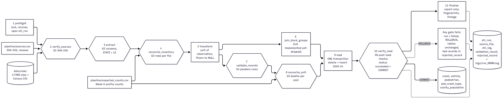

# Week 8: Midpoint Demonstration, Progress Review, and Revised Plan

**Built for Cars, Deadly for Walkers: mining the roadway conditions behind Florida's pedestrian deaths, 2020–2024**

Yelysei Shkirpan · Capstone Project, B.S. Data Science · Eastern Florida State College · October 11, 2026

Repository: https://github.com/Sor1na/florida-pedestrian-patterns

**What this submission is.** A recorded five-to-seven-minute demonstration of the end-to-end pipeline (submitted in Canvas) plus this document, which maps every required item to its evidence in the repository, compares progress against the approved proposal, and revises the plan for Weeks 9–14. The pipeline itself, its gates, logs, rerun behaviour and recovery procedures are the Week 7 deliverable ([`Week7_Pipeline_Shkirpan.pdf`](Week7_Pipeline_Shkirpan.pdf)); this document does not repeat them, it points into them.

| Required item | Where |
|---|---|
| 1. Recorded end-to-end demonstration | the video (Canvas); its exact script and commands are **section 2** |
| 2. Architecture and lineage diagram, source → database | **section 3**: [`pipeline.png`](pipeline.png) and the lineage table (Week 7, section 1) |
| 3. Ingestion, validation, cleaning, transformation, loading procedures | **section 4** (one table pointing to the code and the Week 6–7 documents) |
| 4. Before/after row counts, quality checks, rejected records, transformation log | **section 5** |
| 5. Scheduling/execution, run IDs, logs, rerun, recovery tests | **section 6** |
| 6. Trace of one normal record and one edge case | **section 7**: [`evidence/week8/trace_normal.log`](evidence/week8/trace_normal.log), [`trace_edge.log`](evidence/week8/trace_edge.log), tool [`pipeline/trace.py`](../pipeline/trace.py) |
| 7. Progress against the proposal, approved changes | **section 8** |
| 8. Prioritized risk register and revised Weeks 9–14 schedule | **sections 9–10** |
| 9. Runnable code and supporting evidence | the repository itself; build and run commands in **section 2** and Week 7 section 6.1; CI runs everything on each change |

---

## 1. State of the pipeline at midpoint

Eleven stages, six validation gates, one-transaction loads, rerun-safe by design; merged to `main` in [PR #1](https://github.com/Sor1na/florida-pedestrian-patterns/pull/1) with the tag `week7-pipeline`. Evidence recorded from the committed code: six scenarios, 19 of 19 automatic scenario checks pass (`docs/evidence/week7_synthetic/`); GitHub Actions re-runs the Week 4–5 tests, all six scenarios and both record traces on every change ([`ci.yml`](../.github/workflows/ci.yml), latest run green).

Committed evidence uses **synthetic inputs** in the FARS layout, because real FARS rows describe real deaths and stay out of the public repository (proposal, ethics section). The real 2020–2024 files are pinned by SHA-256 in [`pipeline/sources.csv`](../pipeline/sources.csv); the recorded demonstration runs the pipeline on them locally, which is the first real-data execution, and the same commands write masked evidence to `docs/evidence/week7/`.

## 2. The demonstration: script, commands, and how it was recorded

**Setup before recording** (once, not in the video), PowerShell in the repository root, with PostgreSQL 16 installed:

```powershell
git pull
pip install -r requirements.txt
$env:PGUSER = "postgres"; $env:PGPASSWORD = "<your password>"   # this window only; never stored in a file
$PSQL = "C:\Program Files\PostgreSQL\16\bin\psql.exe"
& $PSQL -d postgres -c "CREATE DATABASE ped_safety;"            # skip if it exists
& $PSQL -d ped_safety -v ON_ERROR_STOP=1 -f sql/00_build_all.sql
# failure scenarios take minutes, so they are recorded as logs beforehand, not live:
python pipeline/run_scenarios.py --raw-dir "E:\College\Data Management\raw" --psql $PSQL
```

The last command rebuilds its own database (`ped_safety_week7`), runs all six scenarios on the **real** files and writes `docs/evidence/week7/` with case numbers, CSV lines and record values masked.

**The video itself** (target 6:00–6:45; one take over a clean terminal):

| Time | On screen | Say |
|---|---|---|
| 0:00–0:40 | `docs/pipeline.png` | The question, the three sources, and the shape: eleven stages, six gates, nothing publishes unless every gate passes. |
| 0:40–1:10 | `type pipeline\sources.csv`, then `certutil -hashfile "E:\College\Data Management\raw\FARS2023NationalCSV.zip" SHA256` | Provenance: every input is pinned by SHA-256 from the Week 6 manifest; gate G1 recomputes this before reading a byte. |
| 1:10–2:40 | `python pipeline\etl.py run --raw-dir "E:\College\Data Management\raw"` | The end-to-end run on the real files, live. Point at: G1 PASS lines, rows in→out per file (41,133 Florida person rows → 3,736 pedestrian fatalities), G5 totals per year, "COMMITTED, status = succeeded", the per-year lineage lines. |
| 2:40–3:20 | the same command again, then `python pipeline\etl.py snapshot` | Rerun safety: every year reads "deleted N, inserted N"; the content fingerprint is identical, so the rerun changed nothing. |
| 3:20–4:10 | `notepad docs\evidence\week7\03_failure_tampered_file.log` and `04_failure_bad_records.log`; live: `python pipeline\etl.py status` and `python pipeline\etl.py rejected --redact-keys` (against `ped_safety_week7`: `$env:PGDATABASE="ped_safety_week7"`) | Failure behaviour, recorded from the same real files: an edited zip dies at G1 with nothing read; four injected bad records are quarantined in `rejected_record` at G4 with file, line and rule; the tables keep the previous load both times. |
| 4:10–5:10 | `$env:PGDATABASE="ped_safety"`; `python pipeline\trace.py --pick normal --raw-dir "E:\College\Data Management\raw"` then `--pick edge` | One record end to end: the CSV line in the zip, each cleaning rule next to its effect, the stored rows, the items it contributes to the analysis view, the county rate it is counted in. The edge case shows FARS filler coordinates becoming NULL while the death is kept. |
| 5:10–6:10 | this document, sections 8–10 | Progress against the proposal, the top risks, the revised Weeks 9–14 plan. |
| 6:10–6:40 | the repository on GitHub: README, green CI badge/run, `docs/evidence/` | Everything shown is in the repository; CI re-runs the tests, all six scenarios and both traces on every change. |

**Recording steps (Windows).**

1. Tool: OBS Studio (free) with a Display Capture scene, or, simplest, **Win+Alt+R** (Game Bar) for full-screen capture. 1920×1080, 30 fps, MP4.
2. Terminal: Windows Terminal maximized, font 18–20 pt (`Ctrl` + `=`), dark theme, `cls` before starting.
3. Keep this section open on a second screen or printed; paste commands from it rather than typing, so the take has no typos.
4. Do one full dry run with a stopwatch; the live `etl.py run` on the real files takes well under a minute, so the timing above holds.
5. Record audio in one take with a headset mic; a 10-second test clip first.
6. Name the file `Week8_Midpoint_Demo_Shkirpan.mp4`. After uploading to Canvas, download it back and play it to the end: the submission requirements ask for every uploaded file to be verified.
7. Nothing sensitive appears on screen: the password is typed before recording and never echoed; FARS is public-domain data, and the quarantine listing is shown with `--redact-keys`.

## 3. Architecture and lineage



Source → database in one picture (source: [`pipeline.mmd`](pipeline.mmd)): pinned raw files and the two control files enter on the left; hexagons are gates; the load and its post-load verification are one transaction; every run leaves bookkeeping rows and a log file whether it succeeds or fails. The full lineage table (file → member → filter → table, with the Week 6 profile counts and the synthetic run counts side by side) is Week 7, section 1; the per-year lineage lines of the latest load are printed by stage `finalize` and shown in the video.

## 4. Procedures

| Procedure | Where it runs | Written down in |
|---|---|---|
| Ingestion (pinned download set, integrity) | stages 1–3, gates G1–G2 | Week 7 §1; Week 6 §1 (what was downloaded, encodings) |
| Validation (structure, inventory, record rules, totals, post-load) | gates G2–G6; pandera schemas in [`etl.py`](../pipeline/etl.py) `raw_schema` / `unit_schema` | Week 7 §1, §4; Week 6 §4 (the rules the gates implement) |
| Cleaning (what changes and what never does) | stage 5 | Week 6 §4 (five issues, fixed before any transformation); Week 7 §1 stage table |
| Transformation (unit of observation, discretization) | stage 5 + view `v_ped_transactions` ([`04_views.sql`](../sql/04_views.sql)) | Week 6 §4 issue 4 (bins fixed in advance); Week 5 design |
| Loading (replace-by-year, one transaction, triggers) | stages 9–10 | Week 7 §1, §3 |

## 5. Row counts, quality checks, rejected records, transformation log

**Before/after counts.** Real files (measured in Week 6, enforced by G3/G5 on every load) and the committed synthetic run side by side:

| Step | Real (expected) | Synthetic run 1 (recorded) |
|---|---|---|
| person rows, Florida → pedestrian fatalities | 41,133 → 3,736 (by year 695/819/780/774/668) | 3,394 → 596 |
| accident rows, Florida → crashes with a pedestrian death | 15,959 → 3,690 | 1,304 → 547 |
| pbtype rows, Florida → typing records | 5,193 → 3,736 | 876 → 596 |
| census rows → county × year | 3,195 → 335 (67 × 5) | 79 → 67 → 335 |
| deaths → analysis view (urban, non-freeway) | 3,736 → 3,053 | 596 → 499 |
| load, rerun | every year "deleted N, inserted N", fingerprint unchanged | same, `c0656528b64a…` |

**Quality checks:** 93 named checks per successful run in `validation_result`, each with expected and actual values (one warning-only check open: block-group share, EPA join pending). **Rejected records:** scenario 4 quarantined 5 records with file, member, CSV line, key, rule, column and value ([`04_failure_bad_records.log`](evidence/week7_synthetic/04_failure_bad_records.log)); zero rejected on clean inputs, and the gate tolerates zero. **Transformation log:** every step writes `rows_in`/`rows_out` to `etl_log` and the run log; the trace of section 7 shows the same rules applied to one record.

## 6. Execution, scheduling, run identifiers, rerun, recovery

- **Execution** is one command (`python pipeline/etl.py run`), safe to repeat at any time; `status`, `rejected`, `snapshot` read the state back. Exit codes and per-gate recovery: Week 7 §6.
- **Scheduling.** The sources change at most once a year (the 2024 Final file), so the pipeline is run on demand rather than on a timer, and that is a documented decision (Week 7 §9). Automation exists where change actually happens: **GitHub Actions runs the whole test-and-scenario suite, plus both record traces, on every push and pull request.** If a schedule is ever wanted, the one-liner for Windows Task Scheduler is `schtasks /Create /SC MONTHLY /TN ped_safety_etl /TR "python <repo>\pipeline\etl.py run"`.
- **Run identifiers and logs:** every run gets `run_id` in `etl_run`, carried on every line of `logs/run_NNNN_<start>.log`, every `etl_log`, `validation_result`, `source_file` and `rejected_record` row.
- **Rerun and recovery tests:** scenarios 2 (rerun, identical fingerprint), 3 and 4 (two deliberate failures, tables unchanged), 5 and 6 (kill inside the load; restart closes the abandoned run) — recorded in `docs/evidence/week7_synthetic/` and re-run by CI.

## 7. Trace of one normal record and one edge case

New this week: [`pipeline/trace.py`](../pipeline/trace.py) follows one record through every hop and quotes the evidence — lineage (run, file, SHA-256, release), the record's own CSV lines inside the zip with line numbers, each cleaning rule next to its effect on this record, the stored rows and their constraints, the items contributed to `v_ped_transactions` (or the scope reason it stays out), and the county-rate row the death is counted in. It is read-only and works unchanged on real and synthetic data; `--redact` masks case numbers.

Committed traces (synthetic, against the same load as the Week 7 evidence; CI re-runs both):

- **Normal record** — [`trace_normal.log`](evidence/week8/trace_normal.log): a single-victim urban crash; all links resolve; 1 of 2 person rows kept by the unit filter; in the view with 16 items; counted in Volusia's rate.
- **Edge case** — [`trace_edge.log`](evidence/week8/trace_edge.log): raw `LATITUDE=77.77770000 LONGITUD=777.77770000` (the FARS "not reported" filler) → stored `NULL/NULL`, no block group possible, walkability item reads `unknown` — and the death is kept, in the view and in its county's rate, exactly as cleaning-plan issue 5 prescribes.

The video repeats both traces live on the real data (section 2, minute 4–5).

## 8. Progress against the proposal

Plan of record: proposal Appendix C (Week 2/3 documents). Status at the end of course week 8:

| Wk | Planned (Appendix C) | Delivered | Status |
|---|---|---|---|
| 3 | Proposal; download all raw files; checksum manifest | Proposal approved; all six files downloaded 2026-09-27, SHA-256 manifest | ✔ done |
| 4 | Profiling and missingness report; schema, ERD, draft dictionary | Conceptual model, ERD, sample records, business rules (profiling moved to W6) | ✔ reordered |
| 5 | Ingestion and cleaning scripts; code_lookup; first load | Full physical design: 16 tables, code_lookup seeded, 148-column dictionary, 56 constraint tests | ✔ reordered |
| 6 | Validation suite, logging, reconciliation; EPA + Census loads; spatial join. **Milestone 1: database v0.1** | Measured profile of the raw files + evidence-based cleaning plan | ✔ reordered |
| 7 | Analysis view; discretization; baseline frequency tables | Validated, logged, rerunnable pipeline + failure/recovery evidence + CI (view and discretization were already built in W5; baseline frequencies measured in W6 §2.4) | ✔ ahead/behind swap |
| 8 | FP-Growth mining; redundancy and template filters | This midpoint package; trace tool; real-data run recorded | ◐ mining not started |

**Net position.** Milestone 1 (a working, validated database and pipeline) is effectively reached, two items short of the letter of the plan: the **EPA block-group join** (deferred in W7, stage exists and logs itself skipped) and the **real-data load**, whose first execution is this week's recording. The analysis inputs the mining needs (transaction view, fixed bins, baselines) have existed since Weeks 5–6, so mining starts ~2 weeks behind Appendix C with its inputs already in place. Milestone 2 (final rule set) moves from Week 9 to Week 11.

**Changes to the plan, as documented in the graded weekly submissions:** the Week 4–6 content order was rearranged to match the course's weekly deliverables (model → design → profile/cleaning plan, instead of profile → scripts → validation); direct textbook citations were removed from the Week 6 plan after instructor feedback (commit `eb78b61`) and methods grounding now sits in a dedicated section (Week 7 §8); the EPA join moved from Week 6 to Week 9 (declared in Week 7 §9, risk 2 below). The question, sources, unit of observation, ethics rules and mining design are unchanged from the approved proposal.

## 9. Prioritized risk register

| # | Risk | Likelihood | Impact | Midpoint evidence | Response | When |
|---|---|---|---|---|---|---|
| 1 | First real-data load surfaces a code the seeds don't label, or a count mismatch | Medium | High | Pipeline green on synthetic only; real files pinned; G3/G5 totals pre-filled from the Week 6 profile of the same files | Run early in W9 (it is also this week's recording). A rejected code follows the written procedure (Week 7 §6.4: seed + migration, rerun); nothing is dropped silently | W9 |
| 2 | EPA block-group join (only unbuilt stage) slips again | Medium | Medium | Stage logs itself skipped; walkability = `unknown` for 100% of view rows; Objective 1 tolerates ≤10% missing | Implement in W9 (geopandas point-in-polygon, county-digit consistency check per issue 5). Fallback, already in the proposal: county-level population-weighted walkability | W9 |
| 3 | Mining window compressed (starts W10, was W8) | High | Medium | View, bins and baselines ready since W5–W6, so the two lost weeks were spent making reruns safe, not on inputs | Mining W10, evaluation W11; Milestone 2 re-dated to W11; report drafting starts from the baseline tables in parallel | W10–11 |
| 4 | Mining returns trivial or unstable rules | Medium | Medium | Not started; filters specified in the proposal | Closed itemsets, template filters, lift ranking, 4-of-5-year stability, permutation baseline, 2024 hold-out — all pre-committed, not tuned after the fact | W10–11 |
| 5 | NHTSA publishes the 2024 Final file mid-project | Medium | Medium | 2024 tagged `Annual Report File` in `source_file`; replace-by-year proven by scenario 2 | Written acceptance procedure (Week 7 §6.5); re-run pipeline, re-run hold-out, report both ARF and Final numbers | any |
| 6 | Weeks 12–14 compression against the strict Week 14 package deadline | Medium | High | Original buffer weeks (15–16) do not exist in the course calendar | Scope guard, decided now: corridor labels and secondary dashboard views are cut first; data quality, rule evaluation and the report are never cut | W12–14 |
| 7 | Tableau licence limits for the dashboard | Low | Medium | Not started | Plotly Dash fallback named in the proposal; county choropleth + pattern explorer are library-agnostic | W12 |

## 10. Revised schedule, Weeks 9–14

| Course week (due Sunday) | Work | Gate / milestone |
|---|---|---|
| 9 (Oct 18) | Real-data load finalized on the local machine, masked evidence committed (`docs/evidence/week7/`); EPA SLD downloaded and pinned; `block_group` load + spatial join implemented with the county-digit check; block-group share check promoted from warning to gate | **Milestone 1 closed: database v1.0, tagged** |
| 10 (Oct 25) | Baseline frequency and pairwise tables from the database; FP-Growth (mlxtend) at the proposal's thresholds; closed-itemset and template filters | candidate rule set |
| 11 (Nov 1) | Four-of-five-year stability, swap-randomization permutation baseline, 2024 hold-out (labelled provisional) | **Milestone 2: final rule set** (was W9) |
| 12 (Nov 8) | County rates and choropleth; pattern explorer with rule-as-sentence rendering; countermeasure matrix draft | dashboard skeleton |
| 13 (Nov 15) | Dashboard completed + planner walk-through test; report draft (~15 pp) with limitations and bias statements | report draft |
| 14 (Nov 22, strict) | Final package: report, presentation, clean-clone rebuild check, final repository tag | **Milestone 3: final submission** |

Slack: the dashboard skeleton (W12) and report draft (W13) can swap if mining evaluation spills into W12; the scope guard of risk 6 applies after that.

---

## Sources and AI assistance

- Tan, P.-N., Steinbach, M., Karpatne, A., & Kumar, V. (2019). *Introduction to data mining* (2nd ed.). Pearson. Chapter 2 (data quality), chapters 5–6 (association analysis) — the methods basis carried through Weeks 6–7.
- National Highway Traffic Safety Administration. (2026). *FARS National CSV files 2020–2024*. https://static.nhtsa.gov/nhtsa/downloads/FARS/
- U.S. Census Bureau. (2026). *County population totals 2020–2025, Vintage 2025*. https://www.census.gov/data/tables/time-series/demo/popest/2020s-counties-total.html
- U.S. Environmental Protection Agency. (2021). *Smart Location Database v3 / National Walkability Index*. https://www.epa.gov/smartgrowth/smart-location-mapping

I used Claude (Anthropic), an AI assistant, to help build the trace tool, assemble this document, and draft the demonstration script. The traces in `docs/evidence/week8/` come from the assistant's Linux environment on synthetic data; the recorded demonstration was made and narrated by me on my machine with the real files. The question, scope, plan and all decisions on changes come from my approved proposal and my Week 3–7 work. I reviewed the generated material and I am responsible for the content.
